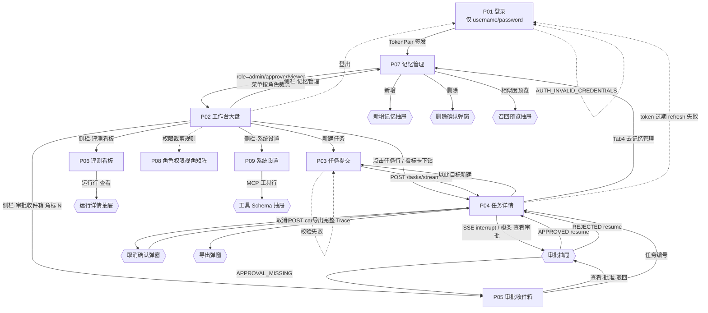

# AgentFlow 前端 UI 原型设计规范 v1.0

> 项目：AgentFlow —— 企业级多智能体任务编排与执行平台
> 交付物类型：**UI 原型方案**（页面结构 / 布局 / 组件 / 交互 / 状态 / 跳转关系 / 接口对齐说明）
> 不含任何前端实现代码，不含构建配置，不涉及框架选型。
> 设计语言基线：ArcoDesign B 端规范；面向企业内部运营人员，专业克制、信息密度高。
> 对齐后端：v1.0.0（FastAPI，`/api/v1`，7 张 MySQL 表，REST + SSE）

---

## 0. 文档定位与事实基线

### 0.1 本文档回答什么

| 编号 | 交付内容 | 章节 |
|---|---|---|
| D1 | 页面清单、信息架构、角色可见性 | §2 |
| D2 | 每个页面的布局、区块、组件、交互、状态 | §3、§4 |
| D3 | 全部状态视觉样式（任务 / 子任务 / 审批 / 评测 / 加载 / 空 / 异常） | §1.6、§4.3 |
| D4 | 页面跳转流程图 + 弹窗/抽屉触发时机 | §5 |
| D5 | SSE 流式更新与轨迹回放交互规则 | §6 |
| D6 | 前端对接注意事项（逐区块字段级映射 + 缺口清单） | §7 |

### 0.2 后端事实基线（设计只能建立在这些之上）

**7 张表（字段即 UI 可用字段上限）**

| 表 | 关键字段（原文） |
|---|---|
| `users` | id, username, password_hash, role(admin/approver/viewer), status(1/0), last_login_at, created_at |
| `tasks` | id, task_no(`AF20261020-0001`), creator_id, goal, time_range{start,end}, status, replan_count, token_usage, trace_id, result_artifact_id, error{code,message,span_id}, finished_at, created_at |
| `subtasks` | id, task_id, seq, name, description, tool_hint, depends_on[], risk_level, status, result_summary, artifact_ids[], retry_count |
| `task_executions`（span） | id, trace_id, span_id, parent_span_id, task_id, subtask_id, node, event, tool_name, tool_error, input_tokens, output_tokens, latency_ms, payload, started_at |
| `approvals` | id, task_id, subtask_id, type(HIGH_RISK_TOOL/LARGE_SCAN), reason, payload, status(PENDING/APPROVED/REJECTED/EXPIRED), requested_by, decided_by, decide_comment, decided_at, expires_at |
| `memories` | id, scope(short/mid/long), user_id, task_id, content, chroma_doc_id, importance(1~5), hit_count, expires_at |
| `eval_runs` | id, run_no, source(reviewer_gate/regression/ab_test), dataset_id, variant(compress_on/compress_off), ext_run_id, metrics{task_completion,plan_f1,tool_acc,token_cost,latency_p50,latency_p95}, status(PENDING/RUNNING/DONE/FAILED), detail |

**已实现接口（真实存在，可直接对接）**

| 方法 | 路径 | 说明 |
|---|---|---|
| POST | `/api/v1/auth/login` | 返回 access_token / refresh_token / token_type / expires_in |
| POST | `/api/v1/auth/refresh` | refresh 一次性消费，重复使用报 `AUTH_REFRESH_REVOKED` |
| POST | `/api/v1/auth/logout` | access token 进黑名单 |
| GET | `/api/v1/auth/me` | id / username / role / status / last_login_at |
| POST | `/api/v1/tasks` | 创建任务（`ainvoke`，无事件） |
| POST | `/api/v1/tasks/stream` | 创建任务 + 流式执行（返回 task_id / trace_id / stream_url 等） |
| GET | `/api/v1/tasks/{task_id}` | 任务详情（含 subtasks / summary / review / eval_score / token_ledger / approvals / artifacts） |
| GET | `/api/v1/tasks/{task_id}/stream` | SSE：`state_update` / `tool_call` / `interrupt` / `complete` |
| GET | `/api/v1/tasks/{task_id}/interrupt` | 审批挂起上下文（paused/type/reason/preview/next_node/expires 等） |
| POST | `/api/v1/tasks/{task_id}/resume` | `{decision, comment, approval_id?, sync?}` 审批并断点续跑 |
| POST | `/api/v1/tasks/{task_id}/cancel` | `{reason?}` 置 CANCELLED |
| GET | `/api/v1/tasks/{task_id}/snapshot` | 完整状态（values / next_nodes / step / interrupt / messages_count） |
| GET | `/api/v1/tasks/{task_id}/trace?after_id=` | 回放：`steps[]` + `checkpoints[]` + `interrupt` + `total_steps` |
| GET | `/api/v1/approvals?page&size` | 审批收件箱（AWAITING_APPROVAL 任务 + PENDING 审批单） |
| GET | `/api/v1/approvals/{approval_id}` | 审批单详情 |
| GET | `/api/v1/memories?page&size&scope&task_id` | 记忆列表（`enabled:false` 表示未启用） |
| GET | `/api/v1/memories/meta` | 分层配置自检（layers / ttl / viewer） |
| POST | `/api/v1/memories/recall` | `{goal, top_k≤3}` 相似度召回（含 score） |
| POST | `/api/v1/memories` | 新增（scope=mid/long, content≤4000, task_id, importance 1~5；仅 admin） |
| GET | `/api/v1/memories/{id}` | 详情 |
| DELETE | `/api/v1/memories/{id}` | 删除（仅 admin） |
| GET | `/api/v1/health`、`/healthz`、`/readyz` | 运行态摘要 / 存活 / 就绪（mysql、redis） |
| POST | `/mcp/v1` | MCP JSON-RPC（initialize / tools/list / tools/call），需 API Key 头 |

统一响应包：`{code, message, data, trace_id}`，`code === "OK"` 为成功。

**节点枚举（DAG 画布只能画这些）**：`planner` / `executor` / `reviewer` / `replan` / `summarizer` / `notifier` / `human_gate`
**工具枚举（工具名直接用连字符）**：`sql-query` / `chart-render` / `kb-search` / `notify`

### 0.3 接口缺口清单（本文档最重要的一页）

以下能力**后端当前不存在**。原型照业务需要设计，但在 §7.4 标注为"待补齐"，联调期必须以开关降级，**禁止前端自行 mock 成真实数据**。

| # | 缺口 | 影响的页面/区块 | 现状证据 |
|---|---|---|---|
| G1 | **任务列表接口**（`GET /tasks` 分页/筛选） | Dashboard 任务表格、克隆入口 | 路由仅有 `POST /tasks`、`GET /tasks/{id}` |
| G2 | **大盘聚合接口** | Dashboard 指标卡 + 三张图表 | 代码中仅预留注释 `GET /dashboards/summary`（W5-Part2 未实现） |
| G3 | **评测接口** | 评测与实验看板整页 | 仅预留注释 `eval/runs`（FR-016 未实现） |
| G4 | **已处理审批列表** | 审批收件箱"已处理"Tab | 仅 `GET /approvals`（返回 AWAITING_APPROVAL + PENDING） |
| ~~G5~~ | ~~用户/角色管理接口~~ → **已裁决**：PRD 无此需求，页面已移除，不再是缺口（账号预置数据库） | — | — | — |
| G6 | **系统配置读写接口** | 系统设置 LLM 参数/开关/日志 | 配置来自 `.env`（`app/core/*_config.py`），无 HTTP 出口；日志仅服务端 |
| G7 | **`TraceStep` 未出参 `span_id`/`parent_span_id`/`subtask_id`** | Trace 面板的 span 标识、子任务↔工具调用精确关联 | 表里有三列，`TraceStep` 只回 `id/trace_id/task_id/node/event/tool_name/tool_error/tokens/latency/payload/started_at` |
| G8 | **建任务入参仅 `goal`/`time_range`/`sync`**（`extra="forbid"`） | 提交页"压缩开关/记忆开关/评测标记" | `TaskCreateRequest` 严格模式，多传字段直接 422 |
| G9 | **批量审批端点**（无） | 审批收件箱批量操作 | 只能逐条 `POST /resume` |
| G10 | **任务导出接口**（无） | "导出完整 Trace 报告" | 需前端基于 `/trace` + `/snapshot` 在浏览器侧组装文件 |
| G11 | **登录失败计数 / 账号锁定 / 登录限流**（均无） | 登录页失败提示、"连续失败锁定"策略 | `auth_service.authenticate()` 只做密码校验，无失败计数；`ErrorCode.RATE_LIMITED` 已定义但**全代码库无抛出点**（无中间件、无装饰器） |
| G12 | **登录响应不含 `role`** | 登录成功后的首屏渲染、导航裁剪 | `POST /auth/login` 返回 `TokenPair`（access/refresh/token_type/expires_in），角色须再调 `GET /auth/me`；多一次 RTT |

### 0.4 字段命名红线

- 详情里的主键叫 **`task_id`**，不是 `id`；子任务主键叫 `id`，序号叫 **`seq`**。
- 时间只有 `created_at` / `finished_at` / `started_at` / `expires_at` / `decided_at`，**没有 `duration`/`elapsed` 字段**，耗时一律前端按时间差计算（`finished_at - created_at`，运行中实时计时）。`complete` 事件里带有 `elapsed_ms`，可用于终态校准。
- `eval_score`、`review.suggestions`、`snapshot.values`、SSE 的 `data` 均为**开放 dict**：键名未在契约中固化，UI 只能"有则展示、无则隐藏"，**不得硬编码不存在的键**。

---

## 1. 设计总纲

### 1.1 设计原则

1. **信息密度优先**：默认 14px 正文 / 13px 表格，卡片间距 16px，首屏尽量容纳"状态 + 指标 + 列表"。
2. **状态即颜色**：所有状态只用 §1.6 定义的五种语义色，不新增颜色表达业务状态。
3. **只读优先**：DAG 画布、Trace、报告均为只读视图；唯一的写操作是"提交 / 取消 / 审批 / 记忆增删"。
4. **一条链路可追溯**：任何异常都能三跳定位：任务 → 节点 → span → payload。`trace_id` 全局可复制，`error.span_id` 可直达 Trace 行。
5. **失败要可解释**：`error.code` 原文透出 + 中文释义 + "下一步建议"，不只弹一句"操作失败"。

### 1.2 栅格与尺寸

| 项 | 规格 |
|---|---|
| 设计基准 | 1440 × 900，最小支持 1280 宽；≥1600 时内容区左右留白不拉伸表格密度 |
| 栅格 | 24 列，gutter 16px，页面左右 padding 20px |
| 左侧导航 | 展开 220px / 收起 48px（可折叠，状态记忆） |
| 顶栏 | 高 56px，白底，底部 1px `#E5E6EB` |
| 内容区 | 背景 `#F7F8FA`，卡片白底，间距 16px |
| 圆角 | 卡片 4px，输入/按钮 2px，徽章 2px，DAG 节点 6px |
| 阴影 | 卡片无阴影仅描边；浮层 `0 4px 10px rgba(0,0,0,.08)` |
| 高度基线 | 表格行 44px（紧凑 36px）、按钮 32px（大 36/小 28）、输入 32px |

### 1.3 色彩系统

**中性色（主体）**

| 用途 | 值 |
|---|---|
| 页面背景 | `#F7F8FA` |
| 卡片/浮层 | `#FFFFFF` |
| 一级文字（标题/数值） | `#1D2129` |
| 二级文字（正文） | `#4E5969` |
| 三级文字（辅助/时间） | `#86909C` |
| 禁用文字 | `#C9CDD4` |
| 边框 | `#E5E6EB` |
| 分割线/表头底 | `#F2F3F5` |

**主色与状态色**

| 语义 | 主色 | 浅底 | 描边 | 用在哪 |
|---|---|---|---|---|
| 品牌/主操作（primary） | `#165DFF` | `#E8F0FF` | `#94BFFF` | 主按钮、链接、选中态、RUNNING 徽章 |
| 成功（success） | `#00B42A` | `#E8FFEA` | `#7BE188` | COMPLETED、DONE、APPROVED、通过 |
| 危险（danger） | `#F53F3F` | `#FFECE8` | `#FBACA3` | FAILED、驳回、取消确认、错误码 |
| 警告（warning） | `#FF7D00` | `#FFF7E8` | `#FFCF8B` | AWAITING_APPROVAL、高危节点、倒计时告警 |
| 信息（info） | `#1677FF` | `#E8F3FF` | `#94BFFF` | 提示条、PLANNING、就绪探针 |
| 中性（default） | `#86909C` | `#F2F3F5` | `#E5E6EB` | CANCELLED、PENDING、SKIPPED、EXPIRED |
| 特殊（purple） | `#722ED1` | `#F5E8FF` | `#D3ADF7` | SUMMARIZING（后端存在该状态，必须有视觉归属） |

> 主色 `#165DFF` 与信息色 `#1677FF` 只差 2 个色阶，因此约定：**主色只用于可点击元素与选中态，信息色只用于信息类标签/提示条**，同一区块内不同时出现。

**图表色序**（按序取用，避免语义冲突）：`#165DFF` → `#00B42A` → `#FF7D00` → `#722ED1` → `#F53F3F` → `#86909C`

### 1.4 字体与数字

| 层级 | 字号/行高 | 字重 | 颜色 |
|---|---|---|---|
| 页面标题 | 20 / 28 | 500 | `#1D2129` |
| 卡片标题 | 16 / 24 | 500 | `#1D2129` |
| 区块小标题 | 14 / 22 | 500 | `#1D2129` |
| 正文/表单 | 14 / 22 | 400 | `#4E5969` |
| 表格/密集文本 | 13 / 20 | 400 | `#1D2129` |
| 辅助说明/时间戳 | 12 / 20 | 400 | `#86909C` |
| 指标数字 | 28 / 36 | 600，`tabular-nums` | `#1D2129` |
| 代码/JSON | 12 / 18，等宽字体 | 400 | `#1D2129`（底 `#F7F8FA`） |

字体族：`PingFang SC, Microsoft YaHei, Inter, system-ui`；所有数字（ID、Token、耗时、金额）必须 `tabular-nums` 右对齐，避免抖动。

### 1.5 基础组件规范（选型即定稿）

| 场景 | 组件 | 规格要点 |
|---|---|---|
| 主操作 | Button type=primary | 每屏最多 1 个主按钮；危险操作使用 status=danger |
| 次操作 | Button type=secondary | 与主按钮间距 8px |
| 文本操作 | Button type=text size=small | 表格行内操作，最多 3 个，超出收进"更多" |
| 表格 | Table | 表头底 `#F2F3F5`，斑马纹关闭，hover 行 `#F7F8FA`，固定操作列，列宽可拖，支持密度切换（默认/紧凑） |
| 筛选 | Input.Search + Select + DatePicker.RangePicker + Tabs/Radio.Group | 筛选区与表格同卡，筛选条件生效后显示"已选 N 项条件 + 重置" |
| 分页 | Pagination | 右侧，显示 `总数`，页容量 10/20/50/100（后端 `size ≤ 100`） |
| 标签页 | Tabs（line 型） | Tab 下划线用主色，Tab 右侧可挂计数徽章 |
| 抽屉 | Drawer（右滑，宽 480 / 560） | 用于审批、记忆编辑、证据查看；底部固定操作栏 |
| 弹窗 | Modal（宽 400 / 520） | 仅用于二次确认与表单型新增；危险确认按钮 `status=danger` |
| 折叠面板 | Collapse | 高级选项、Trace 分组、JSON 分组 |
| 空状态 | Empty | 图形 96px + 一句主文案 + 一句副文案 + 可选主按钮 |
| 加载 | Skeleton（首屏）/ Spin（局部）/ 按钮 loading | 列表首屏用骨架屏，**禁止全屏遮罩** |
| 提示 | Message（轻提示）/ Notification（右上，含标题+描述） | SSE 断线、审批到达用 Notification |
| 状态徽章 | Badge/Tag | 见 §1.6，统一"圆点 + 文案 + 浅底" |
| 悬浮卡 | Tooltip / Popover | DAG 节点 hover 用 Popover（可交互），纯文字提示用 Tooltip |

### 1.6 全量状态视觉映射（唯一口径）

**任务状态 `tasks.status`（7 值，后端枚举）**

| 枚举 | 文案 | 徽章样式 | 圆点 | 附加动效 | 出现位置 |
|---|---|---|---|---|---|
| `PLANNING` | 规划中 | 信息蓝底 `#E8F3FF` / 字 `#1677FF` | ● 实心 | 呼吸 1.6s | 列表、详情头、DAG 的 planner 节点 |
| `RUNNING` | 执行中 | 主色浅底 `#E8F0FF` / 字 `#165DFF` | ● | 呼吸 1.2s + 细进度条 | 同上 |
| `SUMMARIZING` | 汇总中 | 紫底 `#F5E8FF` / 字 `#722ED1` | ● | 呼吸 1.6s | 同上（易被漏掉，必须单列） |
| `AWAITING_APPROVAL` | 待审批 | 橙底 `#FFF7E8` / 字 `#FF7D00` | ● | 闪烁 1s（更醒目） | 列表、详情头、审批收件箱、DAG 的 human_gate |
| `COMPLETED` | 已完成 | 绿底 `#E8FFEA` / 字 `#00B42A` | ✓ | 无 | 全站 |
| `FAILED` | 失败 | 红底 `#FFECE8` / 字 `#F53F3F` | ✕ | 无 | 全站 |
| `CANCELLED` | 已取消 | 灰底 `#F2F3F5` / 字 `#86909C` | ⊘ | 无 | 全站 |

**子任务状态 `subtasks.status`（7 值）**

| 枚举 | 文案 | 视觉 |
|---|---|---|
| `PENDING` | 待执行 | 灰边空心点 `#C9CDD4`，文字 `#86909C` |
| `READY` | 就绪 | 信息蓝空心点 `#1677FF` |
| `RUNNING` | 执行中 | 蓝色旋转环（14px），文字 `#165DFF` |
| `DONE` | 完成 | 绿勾 ✓ |
| `FAILED` | 失败 | 红叉 ✕ + 行内浅红底 `#FFF5F3` |
| `SKIPPED` | 跳过 | 灰勾 + 文案删除线（表示未产出） |
| `CANCELLED` | 已取消 | 灰 ⊘ |

**审批状态 `approvals.status`**：`PENDING` 橙（配倒计时）、`APPROVED` 绿、`REJECTED` 红、`EXPIRED` 灰（文案"已过期"，并整体降透明度 60%）。

**审批类型 `approvals.type`**：`HIGH_RISK_TOOL` → 红底红字（高危工具，最强提示）；`LARGE_SCAN` → 橙底橙字（大范围扫描）。

**评测运行状态**：`PENDING` 灰、`RUNNING` 蓝（+进度条）、`DONE` 绿、`FAILED` 红。

**风险等级 `subtasks.risk_level`**：`high` → 橙色圆角描边标签"高危"，并在 DAG 节点右上角挂橙色三角角标；`normal` → 不显示（避免视觉噪音）。

### 1.7 全局布局框架

```
┌──────────────────────────────────────────────────────────────────────────────┐
│ 顶栏 56px  [Logo AgentFlow]  面包屑：工作台 / 任务详情        [搜索] [通知●] [头像▾] │
├────────────┬─────────────────────────────────────────────────────────────────┤
│ 侧栏 220px │  页面标题区（20px + 一句话说明 + 右侧页面级操作）                    │
│            │  ─────────────────────────────────────────────────────────────  │
│ ▸ 工作台    │                                                                 │
│ ▸ 任务      │                     内容区（24 栅格，间距 16）                    │
│   · 新建    │                                                                 │
│   · 列表    │                                                                 │
│ ▸ 审批收件箱│                                                                 │
│ ▸ 评测看板  │                                                                 │
│ ▸ 记忆管理  │                                                                 │
│ ─────────  │                                                                 │
│ ▸ 系统设置  │                                                                 │
└────────────┴─────────────────────────────────────────────────────────────────┘
```

- 侧栏分组：**业务**（工作台、任务、审批收件箱、评测看板、记忆管理）/ **系统**（系统设置）。
- **v1.0 变更**：移除「用户与权限」页面（PRD 无用户管理需求，账号由管理员预置数据库）；权限控制能力通过 p08 角色视角矩阵页约束，落地为路由守卫 + 按钮显隐。
- 侧栏项带角标：审批收件箱显示待办数（来自 `GET /approvals` 的 `data.total`），0 时不显示，>99 显示 `99+`。
- 顶栏右侧通知：审批到达（SSE `interrupt` 触发的 Notification 汇总）、SSE 断线、评测完成。红点未读态。
- 用户菜单：`username` + 角色徽章（运营管理员/审核人/访客）+ 复制 `trace_id`? 否 → 仅"个人设置（只读）/ 退出登录"。

**角色可见性矩阵（严格来自后端权限实现）**

| 能力 | 运营管理员 admin | 审核人 approver | 访客 viewer |
|---|---|---|---|
| 工作台 | 可见，数据限本人任务 | 可见，全域 | 可见，"任务列表"仅已完成 |
| 新建任务 | ✅（唯一有权限创建的角色） | ❌ 隐藏入口 | ❌ 隐藏入口 |
| 任务详情 | **仅本人创建**（否则 403） | 全部 | **仅 COMPLETED** |
| 详情字段可见性 | 全量 | 全量 | `creator_id` 被剥离；`subtasks` 仅 `seq/name/tool_hint/status/risk_level`（无 description/result_summary/retry_count） |
| 取消任务 | ✅（本人任务） | ✅ | ❌ |
| 审批收件箱 | ✅ 仅本人任务 | ✅ 全量 | ❌ 侧栏隐藏 |
| 审批决策 | ✅（配置允许自审 `APPROVAL_ALLOW_SELF_DECIDE`） | ✅ | ❌ |
| 记忆管理 | 全量读写 | ❌ 侧栏隐藏（PRD：仅 admin） | ❌ 侧栏隐藏 |
| 评测与实验 | 完整视图 | 完整视图 | **仅汇总**（PRD 旅程三：只读） |
| 系统设置 | 读（只读态） | 隐藏 | 隐藏 |

> 侧栏不在矩阵内的项**直接不渲染**，不做灰化——灰化会让人误以为"再申请权限就能用"。

---

## 2. 信息架构与页面清单

```
AgentFlow
├── P01 登录                                    /login
├── P02 工作台大盘 Dashboard                     /dashboard
├── P03 任务提交（新建）                         /tasks/new
├── P04 任务详情（核心）                         /tasks/:taskId
│     ├── 审批抽屉（Drawer）        ← interrupt 触发
│     ├── 取消确认弹窗（Modal）
│     └── 导出报告确认弹窗（Modal）
├── P05 审批收件箱                               /approvals
│     └── 审批抽屉（复用 P04 组件）
├── P06 评测与实验看板                           /eval
│     └── 运行详情抽屉（Drawer）
├── P07 记忆管理                                 /memories
│     ├── 新增/编辑记忆抽屉
│     ├── 删除确认弹窗
│     └── 相似度预览抽屉（recall）
├── P08 角色权限视角矩阵                         （说明页，无路由）
└── P09 系统设置                                 /settings
      └── MCP 工具 Schema 查看抽屉
```

| # | 页面 | 路由 | 主角色 | 页面目的 | 数据完备度 |
|---|---|---|---|---|---|
| P01 | 登录 | `/login` | 全部 | 建立会话，落 token 并由 `/auth/me` 落角色 | ⚠️ 主链路就绪；角色需二次请求（G12） |
| P02 | 工作台大盘 | `/dashboard` | admin/approver | 5 秒看懂"今天跑了多少、卡在哪、为什么失败" | ⚠️ 依赖 G1/G2 |
| P03 | 任务提交 | `/tasks/new` | admin | 用一句自然语言 + 时间范围发起编排 | ✅ 主链路就绪；高级开关受 G8 限制 |
| P04 | 任务详情 | `/tasks/:id` | 全部 | 观察 DAG、追 trace、看报告、处理审批 | ✅ 就绪（span_id 受 G7 限制） |
| P05 | 审批收件箱 | `/approvals` | approver | 批量处理人工闸门，避免流程卡死 | ⚠️ 已处理 Tab 依赖 G4 |
| P06 | 评测看板 | `/eval` | admin/approver | 用数据判断压缩/记忆策略是否值得开 | ❌ 依赖 G3 |
| P07 | 记忆管理 | `/memories` | admin | 管理 mid/long 记忆，验证召回质量 | ✅ 就绪 |
| P08 | 角色权限视角矩阵 | —（设计说明页） | 全部 | 定义三角色侧栏裁剪与按钮显隐规则，取代原用户管理页 |
| P09 | 系统设置 | `/settings` | admin | 只读掌握运行时配置与工具能力 | ⚠️ 部分只读（G6） |

---

## 3. 页面详细设计

### P01 登录页

**目的**：一次完成身份确认；对内部系统而言，登录页只需三件事——可信、快、错误说得清。

**设计前提（重要）：登录页不出现任何"角色选择"控件。**
依据后端事实：`LoginRequest` 只声明 `username` / `password` 两个字段（`app/schemas/auth.py`），角色来自 `users.role` 列，登录链路上没有任何"由用户声明角色"的入口。若前端提供角色 Segmented / Radio，会形成两个问题：① 用户误以为角色可自选，与 RBAC 语义冲突；② 一旦被当作请求参数提交，要么被 Pydantic 静默忽略（暗示"选什么都没用"），要么在开启 `extra="forbid"` 后直接 422。因此角色只做**展示**，不做**输入**。

**布局**：左右 56:44 分栏，左侧品牌区（深中性 `#1D2129` 底 + 48px 极细网格纹理，非插画，内容垂直居中），右侧表单区白底居中 352px。

```
┌──────────────────────────────────┬────────────────────────────────┐
│  [AF] AgentFlow  内部系统         │                                │
│                                  │   登录                          │
│  把一句业务问题                    │   使用企业账号登录，角色与数据   │
│  编排成可追溯的 Agent 任务         │   范围由账号权限自动匹配         │
│  企业级多智能体任务编排平台        │                                │
│  ──────────────────────          │   用户名                        │
│  01 自然语言发起编排               │   [ 👤 ops_zhangsan        ]    │
│  02 LangGraph 多智能体执行         │   密码                          │
│  03 人工审批断点与全链路 Trace      │   [ 🔒 ••••••••        👁 ]    │
│                                  │   ☑ 在此设备保持登录 7 天  忘记密码│
│                                  │   [        登 录            ]    │
│                                  │   ─────────────────────────     │
│                                  │   账号由管理员开通，角色随账号下发 │
│  v1.0.0 · 仅限授权账号访问  © 2026 │   API /api/v1           v1.0.0  │
└──────────────────────────────────┴────────────────────────────────┘
```

**区块与组件**

| 区块 | 内容 | 组件 | 说明 |
|---|---|---|---|
| A 品牌区 | Logo + 产品名 + 「内部系统」标记 + 一句话价值 + 三条能力点 + 版本/版权 | 纯排版 | 深色底降低"营销感"，不加插画/渐变；能力点用 1px 上分隔线做成产品说明列表 |
| B 表单 | 用户名（1–64 字符）、密码（1–128，可切换明文） | Input / Input.Password | 带前置图标；**无角色、无租户、无验证码**（后端均不支持） |
| C 会话保持 | 「在此设备保持登录 7 天」 | Checkbox | 对应 `refresh_token` 的 7d 有效期：勾选存 `localStorage`，不勾选存 `sessionStorage`（关标签页即退出） |
| D 错误提示 | 表单顶部内联 Alert | Alert（error / warning） | 见状态表；错误码映射固定，不拼接后端 `detail` 原文 |
| E 说明与版本 | 账号开通路径说明 + API Base + 版本号 | 纯文本 | 说明"角色随账号下发"是**消除用户困惑的必要文案**，不是装饰；API Base 在生产隐藏 |

**角色从哪来（前端必须按此顺序实现）**

1. `POST /api/v1/auth/login` → 响应 `data` 是 `TokenPair`，**只有** `access_token` / `refresh_token` / `token_type` / `expires_in`，**不含 role**。
2. 拿 access_token 调 `GET /api/v1/auth/me` → `UserOut`，含 `id` / `username` / `role` / `status` / `last_login_at`，**这才是角色来源**。
3. role 只用于前端渲染决策：导航项裁剪、按钮置灰、"仅看本人"默认值。**不作为安全边界** —— 后端每个写接口都挂 `require_role()`，越权由 403 拦截。
4. 不要在本地解 JWT 的 `role` claim 做权限判断：claim 是签发时快照，用户角色被管理员改动后，旧 token 2 小时内 claim 仍是旧值；而 `get_current_user` 每次都从 DB 重读 `users.role`，两者会不一致。解 claim 只可用于首屏骨架期间的"乐观渲染"。

**交互**

1. 用户名框自动聚焦；`Enter` 在任一输入框触发提交；`autocomplete="username"` / `"current-password"` 保留，不拦截浏览器自动填充。
2. 提交 → 按钮 loading + 全表单禁用（防重复，后端无幂等键）；成功写双 Token → `GET /auth/me` → 缓存 `{id, username, role}` → 跳 P02。**跳转目标与角色无关**：三角色共用同一套页面，差异在菜单可见性与数据范围，不做角色专属首页。
3. 失败按 `code` 分支展示（见状态表），401 不清空用户名、只清空密码并聚焦密码框。
4. 携带旧 token 进入 `/login`：无有效 token 则静默清理并留在此页；有有效 token 则直接 `replace` 到 P02（避免二次登录）。
5. 从任意页因 `AUTH_TOKEN_EXPIRED` 且 refresh 失败跳回时，读 `?redirect=` 并在登录成功后回跳。

**状态**

| 状态 | 表现 | 触发 |
|---|---|---|
| 默认 | 用户名自动聚焦，密码框空 | 进入页面 |
| 字段校验失败 | 输入框红边 + 框下 12px 红字（"请输入用户名"/"请输入密码"），聚焦首个错误 | 本地校验，**不发请求** |
| 提交中 | 按钮 loading「登录中」，输入框禁用置灰 | 请求在途，超时 10s 归入网络异常 |
| `AUTH_INVALID_CREDENTIALS` | Alert error「用户名或密码错误 / 请确认后重试，连续失败请联系管理员重置密码。」+ 清空密码并聚焦 | 401；**文案必须与"用户不存在"完全一致**，后端已用 `dummy_verify` 抹平时序差异，前端不得暴露账号是否存在 |
| `AUTH_USER_DISABLED` | Alert error「账号已被禁用 / 请联系管理员恢复」+ 提交按钮置为「账号不可用」不可点 | 403；与 401 分开处理，避免用户反复重试同一账号 |
| `NETWORK_ERROR` / 5xx | Alert warning「无法连接后端服务」+ 回显当前 API Base + 「重试」 | 网络层失败或 5xx；**4xx 业务码不走此分支** |
| `RATE_LIMITED` | Alert warning + 30s 倒计时禁用按钮 | 错误码已定义但后端当前**无抛出点**（见 G11），前端保留分支即可，不必为其做倒计时 UI |

**原型产出对应**：`shots/p01-login.png`（默认态）、`shots/p01b-login-states.png`（6 状态矩阵，开发对照用）。

---

### P02 系统首页大盘 Dashboard

**目的**：运营人员每天第一屏：今天跑了多少任务、完成率如何、有多少卡在审批、花了多少 token、失败都因为什么。

**布局**：纵向四段（筛选栏 / 指标卡组 / 图表区 / 任务表格），筛选栏吸顶。

```
┌────────────────────────────────────────────────────────────────────────────────────┐
│ [时间范围 ▾ 今日] [任务状态 ▾ 全部] [角色筛选 ▾ 仅本人]        [刷新] 更新于 16:52 ⟳30s │
├──────────┬──────────┬──────────┬──────────┬──────────┐                            │
│今日任务量 │任务完成率 │待审批数量 │平均端到端 │总Token   │  ← 5 张指标卡（grid 5 列）  │
│   128    │  92.4%   │    3     │  4m12s   │ 1.24M    │                            │
│ ↑12 较昨日│ ↑2.1pt   │ 需处理 → │ ↓18s     │ ↑8.6%    │                            │
├──────────────────────────────┬──────────────────────┬──────────────────────────────┤
│ 任务完成趋势（面积图）  span12 │工具调用分布（环）span6│失败原因 Top（横条）   span6   │
│                              │                      │                              │
├──────────────────────────────┴──────────────────────┴──────────────────────────────┤
│ 任务列表  [搜索目标/编号] [状态 chips] [列设置] [导出CSV]                            │
│ ┌────────────────────────────────────────────────────────────────────────────┐   │
│ │ 任务编号  目标            状态   创建人  创建时间   耗时  Token  操作          │   │
│ │ AF…0001  分析9月女装GMV…  已完成  张三   10-21 15:02 4m12s 8.2k  查看 克隆 取消 │   │
│ └────────────────────────────────────────────────────────────────────────────┘   │
│                                                        共 128 条   ‹ 1 2 3 › 20/页  │
└────────────────────────────────────────────────────────────────────────────────────┘
```

#### A. 全局筛选栏（吸顶，高 56，白底 + 底部细线）

| 控件 | 组件 | 选项/默认 | 交互 |
|---|---|---|---|
| 时间范围 | RangePicker（含快捷项：今日 / 近 7 天 / 近 30 天 / 自定义） | 默认"今日"（`00:00~now`） | 变更即刷新全部区块；自定义跨度 > 90 天时提示"趋势图将按周聚合" |
| 任务状态 | Select 多选（7 个后端枚举，文案见 §1.6） | 默认空=全部 | 多选后指标卡与图表联动过滤 |
| 角色筛选 | Select（仅 admin/approver 可见）：仅本人 / 全团队 | admin 默认且锁定"仅本人"（后端只允许看本人任务） | approver 可切"全团队"；viewer 不显示该筛选项 |
| 刷新 | Button icon=refresh | — | 手动刷新，转 600ms；失败保留旧数据并顶部提示 |
| 自动刷新 | Switch + 文案"30s" | 默认开 | 刷新时仅刷新指标与表格首行，不重置滚动与筛选 |

#### B. 核心指标卡组（5 张，`grid-template-columns: repeat(5, 1fr)`，窄屏 3+2 折行）

每张卡结构：`标题(13px 三级) + 主数值(28px, tabular) + 单位 + 副行（对比/入口） + 右上角淡图标`

| 指标 | 主值 | 副行 | 数据来源（目标契约） | 无数据时 |
|---|---|---|---|---|
| 今日任务总量 | count(tasks) | 较上一周期 ±N（无对比数据则显示"—"） | G2 `/dashboards/summary.totals.task_total` | `0`，副行"—" |
| 任务完成率 | COMPLETED / 总任务数 | 分母口径 tooltip："不含已取消任务" | 同上 `completion_rate` | `—`（分母为 0） |
| 待审批数量 | count(status=AWAITING_APPROVAL) | "去处理 →"链接跳 P05 | 可先用 `GET /approvals` 的 `data.total` **真实可用** | `0` + "暂无待办" |
| 平均端到端耗时 | avg(finished_at - created_at)（终态任务） | 较上一周期 ±Ns | G2 `avg_e2e_ms` | `—` |
| 总 Token 消耗 | sum(tasks.token_usage) | 千分位 + 单位 K/M | G2 `token_total` | `0` |

> 指标卡点击 = 把该指标"下钻"为表格筛选（如点"待审批数量"→ 表格筛 `AWAITING_APPROVAL` 并滚动到表格）。这是 B 端大盘最省事的联动，不需要新接口。

#### C. 图表区（栅格 24：12 / 6 / 6）

| 图 | 类型 | X/Y | 交互 | 状态 |
|---|---|---|---|---|
| 任务完成趋势 | 面积折线（多序列按状态堆叠/分组） | X=日期，Y=任务数；序列取 7 个状态中实际出现的 | hover 十字准星 + 数值 tooltip；点击某天 → 表格筛该天 | 单点数据时不画线只画点；全 0 时空态"该周期暂无任务" |
| 工具调用分布 | 环形图 + 右侧图例（工具名 · 次数 · 占比） | 维度=`task_executions.tool_name`（`sql-query`/`chart-render`/`kb-search`/`notify`），统计口径 `event='tool.result'` | hover 扇区高亮，图例点击隐藏该序列 | 无调用 → 环形灰环 + "该周期无工具调用" |
| 失败原因 Top | 横向条形（Top 5） | Y=`tasks.error.code` 或 `task_executions.tool_error`，X=次数 | 点击条形 → 表格筛 `FAILED` 并按该错误码过滤 | 无失败 → 空态"该周期无失败任务"（正向反馈，用绿色勾图标） |

#### D. 任务列表表格

| 列 | 宽度 | 内容 | 规则 |
|---|---|---|---|
| 任务编号 | 150 | `task_no` 等宽字体，可点击 | 点击进详情；hover 显示完整编号 |
| 目标 | flex（min 240） | `goal` 单行截断 + Tooltip 全文 | 支持关键字搜索（后端 G1 的 `keyword` 参数；前端不做全量拉取后过滤） |
| 状态 | 96 | 状态徽章 | 运行中状态每 30s 随自动刷新更新 |
| 创建人 | 100 | `creator_id` → 用户名（需后端 join；缺失时显示 `#id`） | admin 只看本人时可整列隐藏 |
| 创建时间 | 150 | `created_at` 格式 `MM-DD HH:mm` | 同年省略年份；hover 显示完整 ISO |
| 耗时 | 90 | `finished_at - created_at`（运行中显示实时计时 `▶ 03:12`） | 右对齐；> 10min 加橙色 |
| Token | 90 | `token_usage` 千分位 | 右对齐；hover 展示 `token_ledger` 节点明细（来自详情接口） |
| 操作 | 160（固定右） | 查看 / 克隆 / 取消 | 取消仅 `PLANNING/RUNNING/SUMMARIZING/AWAITING_APPROVAL` 可点；终态置灰 + Tooltip"任务已结束" |

**工具栏**：左 = 搜索框（300px，回车/search 防抖 400ms）+ 状态 chips（横向可滚动，多选）；右 = 列设置（显示/隐藏列）、密度切换（默认/紧凑）、导出 CSV（**前端导出当前页数据**，非后端接口）。

**交互**
- 行点击 = 进详情；行内"克隆" = 跳 P03 并预填 `goal` 与 `time_range`（**没有克隆接口**，是前端预填，按钮文案用"克隆（预填新建）"或直接"以此目标新建"更诚实——推荐后者）。
- "取消" → 弹窗二次确认（见 §4.2），理由选填。
- 表格空/加载/错误态见 §4.3。

**页面状态**

| 状态 | 表现 |
|---|---|
| 首次加载 | 指标卡骨架（5 个 120px 灰块）、图表骨架（12/6/6 占位）、表格 8 行骨架 |
| 部分接口失败 | 该区块卡内展示 `加载失败` + 重试（不影响其他区块）；顶部 Notification 汇总"N 个区块加载失败" |
| 全部失败 | 页面级错误态（见 §4.3 大错误态），提供"重试"与"查看服务状态"（跳 P09 探针卡） |
| 空数据（有筛选） | 表格空态"没有符合条件的任务" + "清除筛选" |
| 空数据（无筛选） | "还没有任务，创建第一个任务开始编排" + 主按钮"新建任务" |
| 时间范围内 0 任务 | 指标卡显示 0，图表空态，表格空态（三者文案统一口径） |

---

### P03 任务提交新建页（运营管理员）

**目的**：把"一句业务问题 + 一个时间范围"变成一次可执行、可审批、可追溯的编排任务。

**布局**：左右 8:4（栅格 24：主表单 span16，右侧说明 span8，sticky）。

```
┌──────────────────────────────────────────────────┬─────────────────────────────┐
│ 新建任务                                          │  提交后会发生什么             │
│ ┌──────────────────────────────────────────────┐ │  ① 规划 Planner → DAG        │
│ │ 任务目标 *                            0/500   │ │  ② 执行 Executor（MCP 工具）  │
│ │ ┌──────────────────────────────────────────┐ │ │  ③ 高危子任务 → 人工审批 ⏸    │
│ │ │ 例：分析 2026 年 9 月女装类目 GMV 环比   │ │ │  ④ 评审 Reviewer（5 维打分）  │
│ │ │ 下滑原因，输出结论与改进建议             │ │ │  ⑤ 汇总 Summarizer → 报告     │
│ │ └──────────────────────────────────────────┘ │ │  ⑥ 通知 Notifier              │
│ │ 业务时间范围 *  [2026-09-01] ~ [2026-09-30]   │ │                             │
│ ├──────────────────────────────────────────────┤ │  ── 提示 ──                  │
│ │ ▾ 高级选项                                    │ │  · 目标越具体，规划越稳定      │
│ │   同步等待执行  [开关]  说明…                  │ │  · 涉及全量扫描/高危工具会     │
│ │   上下文压缩    [只读·待接入]                  │ │    自动进入人工审批            │
│ │   分层记忆      [只读·待接入]                  │ │  · 提交后可在详情页实时观察    │
│ │   评测标记      [只读·待接入]                  │ │                             │
│ └──────────────────────────────────────────────┘ │                             │
│  [提交并开始执行]  [重置]     ← 主按钮唯一          │                             │
└──────────────────────────────────────────────────┴─────────────────────────────┘
```

**表单字段（严格对齐 `TaskCreateRequest`）**

| 字段 | 组件 | 约束 | 校验时机 | 错误文案 |
|---|---|---|---|---|
| `goal` | Textarea 4 行，`showWordLimit` | 1~500 字（后端 `max_length=500`） | blur + 提交 | "请填写任务目标" / "任务目标不能超过 500 字" / "目标中包含不允许的指令片段，请调整表述"（命中注入黑名单时，服务端返回 `TASK_INVALID`） |
| `time_range.start` / `.end` | RangePicker（date，不可选未来日期） | 必填，`end ≥ start` | change + 提交 | "请选择业务时间范围" / "结束日期不能早于开始日期" / "时间范围不能超过 366 天"（前端软约束） |
| `sync` | Switch，默认关 | boolean | — | 说明文案："开启后请求会阻塞到任务终态或下次挂起，页面可能等待较久（建议仅在脚本化调用时开启）" |
| 压缩 / 记忆 / 评测标记 | 只读展示行 + Tag「待接入」+ Tooltip | — | — | Tooltip："后端 `TaskCreateRequest` 目前仅接受 goal / time_range / sync，额外字段会被拒绝（422）" |

> 设计取舍：这三个开关在 PRD 与页面清单里要求出现，但后端建任务接口不接受。原型保留位置（体现规划意图），视觉上用**只读策略行**而不是可点开关，避免"点了没反应"或"传了报 422"的致命体验。

**交互**
1. 提交 → 按钮 loading，表单只读；调用 `POST /api/v1/tasks/stream`（拿 `task_id` + `trace_id` + `stream_url`），成功立即 `router → P04`，并在详情页**自动建立 SSE**，不等待任何"执行完成"。
2. `sync=false`（默认）：请求应在 2s 内返回；> 3s 未返回显示"正在创建任务…"的持续 loading 文案（不弹错误）。
3. 校验失败不发起请求；服务端 `VALIDATION_ERROR`（422）→ 顶部 Alert + 按 `data` 中的字段定位到具体控件。
4. 重置 → 清空表单（有内容时二次确认"放弃已填写内容？"）。
5. 离页保护：表单脏数据时切换路由 → 弹窗"内容尚未提交，确认离开？"。

**状态**

| 状态 | 表现 |
|---|---|
| 初始 | 光标在目标输入框；时间范围默认"上个自然月"（最常用的分析周期） |
| 输入中 | 字数计数器变色（>450 橙，>500 截断并红字提示） |
| 提交中 | 主按钮 loading "创建中…"，次按钮禁用，右侧说明栏浮层"正在创建任务，请稍候" |
| 提交失败 | 顶部 Alert（error）+ 保留全部输入，按钮恢复可点 |
| 权限不足（viewer/approver 直接访问 URL） | 页面级 403 空态："当前角色无权创建任务"，按钮返回工作台 |

---

### P04 任务详情主页面【核心页面】

**目的**：一屏回答四个问题——**它现在处于什么状态（DAG）、它做了什么（Trace）、它产出了什么（报告）、它需要我做什么（审批）**。

**整体布局**：三段式（头部信息区 / 上半区 DAG 画布 / 下半区 4 Tab），头部吸顶，DAG 与 Tab 之间可拖拽分隔。

```
┌───────────────────────────────────────────────────────────────────────────────────────┐
│ 任务 AF20261021-0007  [执行中]                    [取消任务] [以此目标新建] [导出Trace] │
│ 目标：分析 2026 年 9 月女装类目 GMV 环比下滑原因…（展开）                                │
│ 任务ID 1024 · trace_id 7f3a…c21 [复制] · 张三 · 2026-10-21 15:02 · 8.2K token · 04:12  │
│ 时间范围 2026-09-01~09-30 · 重规划 0 次 · 评测分 —                                        │
├───────────────────────────────────────────────────────────────────────────────────────┤
│ ⚠ 等待人工审批：命中高危工具 sql-query（全表扫描）· 剩余 21h14m      [查看审批]  ← 条件横幅 │
├───────────────────────────────────────────────────────────────────────────────────────┤
│ DAG 画布（只读）   [−][100%][+][适应画布][全屏]  图例：● 完成 ✓ ● 运行中 ● 待审批 ● 失败    │
│                                                                                       │
│  ┌────────┐    ┌────────┐    ┌──────────┐    ┌──────────┐    ┌───────────┐            │
│  │Planner │───▶│Exec #1 │───▶│Human Gate│───▶│Exec #2   │───▶│Summarizer │            │
│  │ ✓ 1.2s │    │ ✓ 3.4s │    │ ⏸ 待审批 │    │ ○ 待执行 │    │ ○         │            │
│  └────────┘    └────────┘    └──────────┘    └──────────┘    └───────────┘            │
│                                     │                    ┌──────────┐                 │
│                                     └───────────────────▶│Reviewer  │──▶ Notifier      │
├───────────────────────────────────────────────────────────────────────────────────────┤
│ [子任务与工具调用 12] [执行轨迹 Trace 48] [产物与报告] [记忆 3]        ← Tabs          │
│                                                                                       │
│  （Tab 内容区，最小高 380，内部独立滚动）                                                │
└───────────────────────────────────────────────────────────────────────────────────────┘
```

#### A. 页面头部（信息区，吸顶，滚动时压缩为单行）

**上行（标题行）**：`task_no`（等宽 16px）+ 状态徽章 + 右侧操作组。

| 操作 | 组件 | 可用条件 | 行为 |
|---|---|---|---|
| 取消任务 | Button(status=danger) | 状态 ∈ {PLANNING, RUNNING, SUMMARIZING, AWAITING_APPROVAL} 且角色 ∈ {admin, approver} | 弹窗二次确认 + 理由（选填，写入 `task.error.message`）→ `POST /cancel` → 状态置 CANCELLED，SSE 收尾 |
| 以此目标新建 | Button | 全部 | 跳 P03 预填 `goal` + `time_range`（**无克隆接口**） |
| 导出完整 Trace 报告 | Button | 全部（viewer 仅完成态） | 弹窗选择范围（全量 / 仅异常）→ 前端基于 `/trace` + `/snapshot` + 详情组装 JSON/Markdown 并下载（G10：无后端导出） |
| 刷新 | Button(icon) | 全部 | 重新拉取 detail + trace + snapshot |

**下行（元信息行）**：8 项紧凑排布（每项 `标签 12px #86909C` + `值 13px`），超宽折行。

| 项 | 字段 | 展示规则 |
|---|---|---|
| 任务 ID | `task_id` | 等宽；点击复制 |
| trace_id | `trace_id` | 前 8 位 + `…` + 后 4 位，**一键复制全文**（复制成功 Message："trace_id 已复制"；这是全链路排障的入口，必须最好用） |
| 创建人 | `creator_id` | 需用户名映射，缺失显示 `#1024`；viewer 视角该字段不存在 → 整项隐藏 |
| 创建时间 | `created_at` | `YYYY-MM-DD HH:mm:ss` |
| 总 Token | `token_usage` | 千分位；hover 弹出 `token_ledger` 节点明细表（节点 / 输入 / 输出 / 是否压缩 / 调用次数） |
| 总耗时 | `finished_at - created_at` | 终态显示定值；运行中显示 `▶ mm:ss` 实时计时（每秒，仅在 RUNNING/SUMMARIZING 时启） |
| 业务时间范围 | `time_range.start ~ end` | 原样 |
| 重规划次数 | `replan_count` | 0 正常灰；≥1 橙色标签（说明计划被推翻过，往往是价值线索）；hover："上限 2 次" |

**目标描述**：默认 2 行截断，右侧"展开/收起"；展开后最多 8 行内部滚动。长文本中若含链接，不做自动识别（避免误判 SQL）。

**异常条（状态驱动，条件渲染）**
- `FAILED`：红条 `错误码 TASK_EXECUTION_ERROR` + `error.message` + "定位到 Trace 步骤"（若 `error.span_id` 存在，跳转并高亮对应行；不存在则按 code 过滤）。
- `CANCELLED`：灰条 "任务已取消 · 原因：{error.message}"。
- `AWAITING_APPROVAL`：橙条 "等待人工审批 · 类型 {type} · 原因 {reason} · 剩余 {倒计时}" + 主按钮"查看审批"（打开审批抽屉；无审批权限的角色只展示"等待审核人处理"）。
- `COMPLETED` 且 `degraded` 相关信号（来自 snapshot/review 的 degraded 标记）：黄条 "本次结果存在降级（部分工具降级或评审跳过）"，可点开查看原因。

#### B. 上半区：DAG 编排画布（只读）

**画布规格**

| 项 | 规格 |
|---|---|
| 高度 | 默认 420px，可拖拽 320~640px；"全屏"进入 90vh 浮层（内部仍只读） |
| 布局 | 从左到右分层；主轴为固定骨架 `planner → executor 组 → (human_gate) → reviewer → summarizer → notifier`；`replan` 作为回边从 `reviewer/human_gate` 折回 `planner` |
| 节点尺寸 | 168 × 64（图标 32 + 主标题 13px + 副行 11px） |
| 节点内容 | 类型图标 + 类型名（Planner/Executor/审批/Reviewer/Summarizer/Notifier/Replan）+ 状态符号 + 耗时（有则显示 `1.2s`） |
| 连线 | 1.5px `#C9CDD4`，圆角正交折线，箭头 6px；执行中的连线为流动虚线（1.2s 循环，主色） |
| 缩放 | 滚轮 0.5x~1.5x，双击 100%，右上角显示比例 |
| 小地图 | 右下角 160×100，节点多时显示视口框（>8 节点才显示） |
| 图例 | 右上角：✓ 完成 / 运行中 / ⏸ 待审批 / ✕ 失败 / ○ 未开始 |

**节点状态视觉**

| 状态 | 边框 | 底色 | 角标 | 动效 |
|---|---|---|---|---|
| 未开始 | `#E5E6EB` | `#FFFFFF` | 灰空心圈 | 无 |
| 运行中 | `#165DFF` 2px | `#F7FAFF` | 蓝色旋转环 | 外发光呼吸（2s） |
| 完成 | `#00B42A` 1px | `#FFFFFF` | 绿勾 | 完成后 300ms 勾选动画（一次性） |
| 失败 | `#F53F3F` 2px | `#FFF5F3` | 红叉 | 轻微抖动 1 次 |
| 待审批（human_gate） | `#FF7D00` 2px，虚线 | `#FFF7E8` | 橙色暂停 + 呼吸 | 持续呼吸，最高视觉优先级 |
| 高危子任务节点 | 常规状态边框 | 右上角橙色三角 | "!" | 无（避免与待审批抢注意力） |
| 跳过/取消 | `#E5E6EB` 虚线 | `#FAFAFA` | 灰勾/灰⊘ | 整体 60% 透明 |

**hover 悬浮卡（Popover，240~300px）**

| 字段 | 来源 |
|---|---|
| 节点名称 + 类型徽章 | `node` 枚举映射 |
| 状态 + 耗时 | 该节点最近一条 `event='exit'` 的 `latency_ms`（无则"—"） |
| 子任务名/序号（executor 节点） | `subtasks[].name / seq` |
| 工具 | `tool_name`（executor 节点聚合展示，多于 1 个显示"等 N 个"） |
| Token | 该节点 `input_tokens + output_tokens` 汇总 |
| 错误 | `tool_error` 或 `error.message`（首行 60 字截断） |
| 操作 | "在 Trace 中查看"（切到 Tab2 并过滤该节点）、"查看子任务"（切到 Tab1 并展开对应行） |

**交互**
1. 单击节点 = 选中（蓝色描边）+ 联动下半区（executor → Tab1 定位；其他 → Tab2 过滤）。
2. 双击节点 = 打开该节点 span 详情侧栏。
3. 空白处拖拽平移；`Esc` 取消选中。
4. 只读：节点不可拖拽、不可连线、不出现"编辑"入口；右上角灰色 Tag「只读视图」+ Tooltip "编排编辑能力规划在后续版本"。

**数据构建规则（必须写清，否则画不出来）**
- 骨架节点：`planner`、`reviewer`、`summarizer`、`notifier` 恒显示；`human_gate` 仅当存在审批（`approvals` 非空或 `status=AWAITING_APPROVAL` 或任一子任务 `risk_level=high`）时插入到高危子任务之后。
- executor 节点：一个子任务一个节点，位置按 `seq`，连线按 `depends_on`（空数组 = 依赖前一个 seq）。
- `replan` 节点：`replan_count > 0` 时显示回边，标注"重规划 ×N"。
- 节点耗时/状态：以 `subtasks.status` 为主，`trace` 的 `enter/exit` 做补充（task_executions 里 `node=executor` 的多个 span **无法精确归属到具体 seq**，见 G7 → 因此 executor 节点耗时优先取 Trace 中与该子任务时间窗最接近的 exit span，并在悬浮卡标注"耗时近似值"）。

#### C. 下半区：4 个 Tab

**Tab 通用规则**：Tab 标题带计数（与数据量同步）；切换不重置其他 Tab 的滚动位置；URL 带 `?tab=trace` 支持深链；刷新页面回到默认 Tab1 或 URL 指定 Tab。

##### Tab1 · 子任务与工具调用（默认 Tab）

**布局**：左 = 子任务树/表（span 14），右 = 选中子任务的详情面板（span 10，宽 ≥ 420）。

```
┌──────────────────────────────┬────────────────────────────────────────────┐
│ ▾ #1 拉取9月GMV明细           │ #1 拉取9月GMV明细        [高危] [DONE]      │
│   工具 sql-query  高危  完成  │ 描述：按类目汇总 9 月 GMV…                  │
│ ▾ #2 计算环比与同比           │ 结果摘要：女装 GMV 环比 -12.4%…             │
│   工具 sql-query  完成        │ ── 工具调用（2）──────────────────────────  │
│   #3 生成趋势图               │ ▸ sql-query  call   15:02:11  入参 JSON ▾  │
│   工具 chart-render 运行中    │ ▸ sql-query  result 15:02:14  1.8s ✓      │
│   #4 检索历史复盘             │   ── 近 7 天同类任务 3 条 ──               │
│   工具 kb-search  待执行      │ 重试次数 0 · 产物 1 个                      │
└──────────────────────────────┴────────────────────────────────────────────┘
```

| 区块 | 内容 | 组件 | 字段 |
|---|---|---|---|
| 左：子任务列表 | 层级按 `depends_on` 缩进（无依赖为根）；每行：`#seq` + 名称 + 工具标签 + 风险标签 + 状态 | Tree 或 Table（可切换视图，默认 Table） | `seq`、`name`、`tool_hint`（映射为工具名显示 `sql-query` 等）、`risk_level`、`status`、`retry_count` |
| 左：表格列（视图=表） | 序号 / 名称 / 工具 / 风险 / 状态 / 重试 / 操作 | Table | 同上（不含耗时，因后端未按子任务出参） |
| 右：基本信息 | 名称、状态徽章、风险徽章、描述、结果摘要 | Descriptions | `name`、`description`、`result_summary`、`status`、`risk_level` |
| 右：工具调用 | 调用列表：工具名 + phase（call/result）+ 时间 + 耗时 + ok/error_code + 入参/返回 JSON（可展开、格式化、复制、搜索） | Collapse + 代码块 | 来自 `/trace` 的 `steps[]`：`tool_name`、`event`（`tool.call`/`tool.result`）、`payload`、`latency_ms`、`tool_error`、`started_at` |
| 右：产物 | 该子任务的产物引用列表 | List | `artifact_ids[]` → 需与 `artifacts[].artifact_id` 匹配（匹配不到显示"产物引用缺失"） |

**重要限制（必须在 UI 上显式表达）**：`TraceStep` 不含 `subtask_id`，右侧"工具调用"是按 **节点 + 时间窗** 近似聚合的（`node=executor` 且 `started_at` 落在本子任务执行区间）。因此：
- 面板顶部放一条 12px 灰色说明："工具调用按时间窗近似归属（接口未返回 subtask_id）"；
- 若该子任务区间内无步骤 → 显示"暂无调用记录"，不显示"0 次调用成功"这类断言。

**交互**
- 点左侧行 → 右侧切换（右侧有宽度动画 200ms）；
- 工具调用行点击展开 JSON；JSON 提供"复制"、"仅看错误字段"、"折叠全部"；
- 错误码 `tool_error` 出现时，行底色 `#FFF5F3`，右侧红字错误码 + Tooltip 释义（后端错误码如 `TOOL_TIMEOUT` 等原样透出，`error_code` 无值时显示"—"）。

**状态**：加载骨架（左 6 行 + 右 3 块）；空态"规划尚未完成，暂无子任务"（PLANNING 阶段）；错误态"子任务加载失败"+ 重试；viewer 视角 → 右侧隐藏"描述/结果摘要/重试/工具入参"（后端已裁剪字段），改为提示"当前角色仅可查看子任务概要"。

##### Tab2 · 实时执行轨迹回放 Trace（对标 LangSmith）

**布局**：顶部控制条 + 左时间轴（span 15）+ 右详情（span 9，可折叠成底部）。

```
┌──────────────────────────────────────────────────────────────────────────────┐
│ [▶] [0.5x 1x 2x 4x] ──●──────────────── 12/48 ──  [仅看异常 ☐] [节点▾] [事件▾] │
├──────────────────────────────────────────────┬───────────────────────────────┤
│ #12 planner    enter   0.3s  ▇                │ #12 planner / enter           │
│ #13 planner    exit    1.2s  ▇▇▇              │ 15:02:03.221                  │
│ #14 executor   tool.call sql-query   38ms ▏   │ 耗时 1.2s · token 820/210      │
│ #15 executor   tool.result sql-query 1.8s ▇▇  │ ── payload ───────────────    │
│ #16 human_gate enter  (暂停)                  │ {                             │
│ #17 executor   error  TOOL_TIMEOUT 2.4s ▇▇▇   │   "output_keys": [...]        │
│ ...                                          │ }                             │
│                          [回到最新 ↓]         │ [复制 JSON] [搜索键/值]        │
└──────────────────────────────────────────────┴───────────────────────────────┘
```

**顶部控制条**

| 控件 | 行为 |
|---|---|
| 播放/暂停 | 回放模式按 step 顺序推进；实时模式下该按钮变为"暂停自动滚动" |
| 倍速 | 0.5x / 1x / 2x / 4x，切换后立即生效（仅影响后续间隔） |
| 进度滑块 | 拖拽定位到任意 step（显示 `当前/TOTAL`）；拖拽时显示预览时间点 |
| 仅看异常 | 过滤 `tool_error != null` 或 `event='error'` 或节点 FAILED 的步骤 |
| 节点/事件筛选 | 多选 `node`（7 枚举）/ `event`（`enter`/`exit`/`tool.call`/`tool.result`/`replan`/`human_edit`/`error`） |

**左侧时间轴线（每行 = 一个 span 步骤）**

| 列 | 内容 | 说明 |
|---|---|---|
| 序号 | `#id` | 后端只回 `id`（span 行主键）。**UI 文案写"步骤 #id"，不写 span_id**（G7） |
| 节点 | `node` 徽章 | 7 种颜色区分（executor 蓝、planner 紫、human_gate 橙、reviewer 青绿、summarizer 蓝绿、notifier 灰、replan 黄） |
| 事件 | `event` 徽章 | `enter` 空心圆 / `exit` 实心勾 / `tool.call` 箭头 / `tool.result` 方块 / `error` 红叉 / `replan` 循环 / `human_edit` 铅笔 |
| 对象 | `tool_name` | 仅 tool 类事件显示 |
| 耗时条 | `latency_ms` 相对宽度（`latency / max(latency)`，min 4px，max 100%） | 0 值显示 `—`（不画 0 宽条，避免误读为"瞬时"） |
| Token | `input_tokens`/`output_tokens` | 紧凑显示 `820/210` |
| 时间 | `started_at` | `HH:mm:ss.SSS` |

- 分层折叠：按 `node` 分组，"完成"的节点默认折叠（只显示组头 + 步骤数 + 组耗时），当前执行中节点默认展开；组头有 `总耗时 / 步骤数 / token 合计`。
- 异常行：底色 `#FFF5F3`，左侧 3px 红条，`error` 文案单行截断 + hover 全文。
- 新事件追加（SSE）：新行淡入 + 背景高亮 800ms 渐隐；用户手动上滚后停止自动滚动，右下浮出"回到最新 ↓"（带新事件计数）。

**右侧详情面板**

| 区块 | 内容 | 数据 |
|---|---|---|
| 摘要 | 步骤号、节点、事件、时间、耗时、token | `TraceStep` 全字段 |
| 原始 payload | JSON 树/文本（默认折叠一层），支持搜索键值、复制、下载单步 JSON | `payload` |
| 错误 | `tool_error` / `payload.error` 原文 + 错误码释义 | `tool_error` |
| LLM 原文 | "查看模型输入/输出"（弹层）：messages 列表、系统提示、上下文摘要 | `GET /snapshot` → `data.values.messages`（`messages_count` 仅计数） |
| 上下文记账 | 压缩前后 token、是否压缩、保留轮次 | `/snapshot` → `values.token_ledger` / `values.context_meta`（存在则展示） |

**时间轴标记（checkpoints）**：在左侧时间轴顶部绘一条细的 checkpoint 轨道，按 `checkpoints[]`（`step`/`source`/`status`/`next_nodes`/`plan_size`/`done_count`/`created_at`）打点，hover 显示 `step + status + next_nodes + 已完成 done_count/plan_size`。这是"回放到某一步时图处于什么状态"的锚点。

##### Tab3 · 产物与报告

**布局**：左 = 报告正文（span 16）、右 = 评审与证据（span 8，sticky）。

| 区块 | 内容 | 组件 | 字段 |
|---|---|---|---|
| 报告正文 | Markdown 渲染（标题层级、表格、代码块、引用块）；顶部浮出目录（≥3 个标题时） | 渲染区 + 锚点目录 | `detail.summary`（Markdown 字符串，最长 20000） |
| 报告操作 | 复制 Markdown / 下载 `.md` / 全屏阅读 / 打印 | Button 组 | 前端处理 |
| 图表卡片 | 卡片网格（2 列）：标题 + 图 + 类型标签（chart/report/table）+ 下载/放大 | Card + Image | `detail.artifacts[]`：`artifact_id`、`type`、`url`、`title`、`ref` |
| 表格产物 | `type=table` 产物以表格卡展示，点击"查看"在抽屉内渲染（若仅 `ref` 无 `url` → 提示"表格资源地址未返回"） | Card | 同上 |
| 评审卡 | 5 维分数（有据性/忠实度/数字自洽/完整度/格式）横向条形 + 总分 + 通过徽章 + 建议列表 + 降级/跳过标记 | Card + Progress | `detail.review`：`scores{evidence,faithfulness,consistency,completeness,format}`、`total`、`pass`、`suggestions[]`、`degraded`、`skipped`、`skip_reason` |
| 引用证据 | 证据列表：类型（sql/kb/chart/notify/digest）+ 片段 + 来源子任务 | List | 来源于 Trace 中 `tool.result` 的 `payload.result_digest`（`tool_name=kb-search` 即知识库片段） |
| 评测分 | 若 `eval_score` 存在：显示"评测已完成" + JSON 弹层 | Tag + Drawer | `detail.eval_score`（**开放 dict，不硬编码键名**） |

**状态**
- 无报告（RUNNING/PLANNING）：空态插图 + "任务执行完成后将生成报告"，并保留图表区骨架。
- 无报告（COMPLETED 但 `summary` 为空）：`Empty` "本任务未生成报告文本"，附"查看 Trace 定位原因"。
- 图表加载失败：卡片内 broken-image 占位 + "图表加载失败" + 原始 `url` 可复制。
- `artifacts[].url` 实际形态是 `/static/charts/xxx.png`（相对路径）：前端需拼接 API Base 域名；本地开发由 `scripts/dev_serve.py` 把 `storage/` 挂到 `/static`，生产由网关承接。若直连 8000 端口取不到图，属预期，卡片提示"图表静态资源未挂载"，不要重试成死循环。
- 评审缺失：评审卡显示"本次未执行评审"（`review` 为 null），不显示 0 分（0 分是错误信息）。

##### Tab4 · 记忆面板

| 区块 | 内容 | 组件 | 字段 |
|---|---|---|---|
| A 本次命中 | 卡片列表（最多 3 条）：序号 + 一段注入文本（≤200 字，超出折叠） | List + Card | `/snapshot` → `values.memory_hits[]`（字符串数组，**没有 id/score**） |
| B 关联持久记忆 | 表格：`scope` / 内容 / `importance` / `hit_count` / `created_at` / `expires_at` | Table | `GET /memories?task_id={id}&page=1&size=20` → `items[]` |
| C 说明 | 12px 灰字："命中记忆由 Planner 注入（≤3 条）；持久记忆可在记忆管理中维护" | Alert(info) | — |

**状态**
- `memory_hits` 为空：空态"本次未命中历史记忆"（正向，不报错）。
- `GET /memories` 返回 `enabled=false`：Alert warning "分层记忆未启用（`ENABLE_LAYERED_MEMORY=false`），仅展示本次注入情况"，并隐藏 B 区块。
- 加载失败：B 区块错误条 + 重试（不影响 A）。

#### D. 全局审批抽屉（P04 / P05 共用）

**触发时机**
1. 详情页收到 SSE `interrupt` 事件（`phase=awaiting_approval`）→ 自动滑出（仅当当前用户 role ∈ {admin, approver} 且 `resumable=true`）；
2. 详情页橙色横幅"查看审批"；
3. 审批收件箱行内"查看详情"或"批准"。

**结构**（宽 560，右滑，300ms；底部操作栏吸底，高 64）

```
┌──────────────────────────────────────────────────┐
│ 审批 · #128  [HIGH_RISK_TOOL]            ✕       │
│ 任务 AF20261021-0007 · 剩余 21:14:03（橙，<2h 红）│
├──────────────────────────────────────────────────┤
│ 风险原因                                          │
│ 子任务 #2 将执行全表扫描（sql-query），影响行数…   │
│                                                  │
│ 高危子任务（2）                                   │
│  #2 拉取 9 月全量订单明细   工具 sql-query  高危   │
│  #5 关联用户画像宽表        工具 sql-query  高危   │
│                                                  │
│ 产物/参数预览（脱敏）                              │
│  { "sql": "SELECT ...", "estimated_rows": 2.1e6 } │
│  [展开完整 JSON]                                  │
│                                                  │
│ 批准后将继续执行：executor → reviewer → summarizer │
├──────────────────────────────────────────────────┤
│ 驳回意见（驳回必填，作为重规划硬约束）              │
│ ┌──────────────────────────────────────────────┐ │
│ │ 最多 500 字                                   │ │
│ └──────────────────────────────────────────────┘ │
│                        [ 驳 回 ]  [ 批 准 ]      │
└──────────────────────────────────────────────────┘
```

| 区块 | 字段来源 |
|---|---|
| 审批号 / 类型 | `approval_id` / `type` |
| 剩余时间 | `expires_at - now`（倒计时每秒刷新；≤2h 红色，≤6h 橙色，已过期为灰"已过期"） |
| 风险原因 | `reason` |
| 高危子任务列表 | `preview.subtasks[]`（或收件箱 `risky_subtasks[]`），字段 `seq/name/tool_hint/risk_level` |
| 产物/参数预览 | `preview`（JSON 折叠，脱敏后的数据，前端不再做二次脱敏） |
| 后续节点 | `next_node[]`（数组，按顺序渲染为流程链） |
| 驳回意见 | `comment`（≤500，驳回时必填 ≥2 字） |

**交互**
1. **批准**：二次确认 Modal（"确认批准该审批？批准后任务将继续执行"）→ `POST /tasks/{id}/resume {decision:"APPROVED", comment, approval_id}` → 抽屉关闭 → 页面状态切 `RUNNING`，**重新建立 SSE**（原连接已因 `interrupt` 终止），并 toast "已批准，任务恢复执行"。
2. **驳回**：校验意见 → `{decision:"REJECTED", comment}` → 抽屉关闭 → 状态按返回 `status` 更新（通常进入重规划）→ toast "已驳回，任务将按意见重新规划"。
3. 提交中：底部按钮 loading，抽屉禁止关闭（防重复提交）；失败：保留输入 + 抽屉内红条错误（`APPROVAL_MISSING` → "该审批已被处理或已过期"，操作区变为只读并刷新收件箱）。
4. `resumable=false`：所有操作置灰 + 提示"该断点不可恢复，请取消任务后重新提交"。
5. 抽屉关闭：点遮罩不关闭（避免误触丢意见），仅 `✕` / `Esc` 关闭；有未提交意见时二次确认。

---

### P05 审批收件箱（审核人）

**目的**：把所有卡在人工闸门的任务排成一列，按"最紧急优先"处理，并且能一次处理一批。

**布局**：顶部 Tab（待审批 N / 已处理）+ 工具条 + 表格 + 批量操作条（吸底）。

```
┌────────────────────────────────────────────────────────────────────────────────┐
│ 审批收件箱                                                                    │
│ [待审批 3] [已处理]                                    [刷新] ⟳30s [仅本人 ☐]    │
├────────────────────────────────────────────────────────────────────────────────┤
│ ☐ 任务编号      任务目标            类型          风险原因      过期剩  操作        │
│ ☐ AF…0007  分析9月女装GMV下滑   HIGH_RISK_TOOL  全表扫描…     21:14  [查看][批准][驳回]│
│ ☑ AF…0006  生成Q3经营看板       LARGE_SCAN      扫描区间过大…  1:52⚠  [查看][批准][驳回]│
├────────────────────────────────────────────────────────────────────────────────┤
│ 已选 1 项   [批量批准] [批量驳回]                              ← 吸底批量条        │
└────────────────────────────────────────────────────────────────────────────────┘
```

**待审批 Tab**

| 列 | 宽度 | 内容 | 规则 |
|---|---|---|---|
| 复选框 | 48 | 多选 | 表头全选（当前页） |
| 任务编号 | 140 | `task_no` | 点击 → 新标签打开详情 |
| 任务目标 | flex 260 | `goal` 两行截断 | Tooltip 全文 |
| 审批类型 | 130 | `approval_type` 徽章 | `HIGH_RISK_TOOL` 红、`LARGE_SCAN` 橙 |
| 风险原因 | flex 220 | `reason` 单行截断 | hover 全文 |
| 高危子任务 | 100 | `risky_subtasks.length` 条 + hover 列出名称 | 0 时显示"—" |
| 创建人 | 90 | `creator_id`（→ 用户名，缺失显示 `#id`） | — |
| 创建时间 | 140 | `created_at` | — |
| 过期倒计时 | 120 | `expires_at - now`，`HH:mm:ss` 每秒走 | ≤2h 红 + 闪烁；≤6h 橙；过期灰"已过期"；`expires_at=null` 显示"—" |
| 操作 | 180 固定 | 查看 / 批准 / 驳回 | 批准/驳回直接走抽屉（带上下文），不裸提交 |

**排序**：默认按 `expires_at` 升序（最紧急优先），NULL 排最后；可切换按创建时间。

**批量操作**
- 勾选后底部滑出操作条："已选 N 项" + 批量批准 + 批量驳回 + 取消勾选。
- 批量批准 → 确认 Modal：列出将批准的 N 条 + 提示"**逐条调用审批接口，非原子操作**，部分失败会单独列出"。
- 执行时：操作条变为进度 `3/5 处理中…`，逐条串行 `POST /resume`；结束后弹出结果摘要（成功 N / 失败 M，失败项含 `code` 与原因，可"重试失败项"）。
- 批量驳回：必须填写统一意见（≤500 字），同样逐条串行。

**已处理 Tab（G4：接口待补，一期隐藏）**
- 设计：三个子分组（已批准 APPROVED / 已驳回 REJECTED / 已过期 EXPIRED），表格列：任务编号、目标、类型、处理人 `decided_by`、处理意见 `decide_comment`、处理时间 `decided_at`、结果徽章。
- 一期实现建议：Tab 置灰 + Tooltip "已处理记录接口待接入（`GET /approvals?status=...`）"，不上假数据。

**状态**

| 状态 | 表现 |
|---|---|
| 加载 | 表格 6 行骨架 + Tab 计数骨架 |
| 空（待审批 0） | 绿色勾大图标 + "当前没有待审批任务，流程已清空" + 副文案"有新的审批会实时提醒" |
| 空（已处理 0） | "暂无已处理记录" |
| 新审批到达 | 30s 轮询或 Notification 提示；顶部出现"有 1 条新审批，点击刷新"（不自动插入表格，避免列表跳动） |
| 行内操作冲突（已被他人处理） | 该行置灰 + 灰标签"已被处理"，操作按钮禁用；toast "该审批已被其他审核人处理" |
| 权限不足（viewer） | 侧栏隐藏；直接访问 URL → 403 空态 |

---

### P06 评测与实验看板

> 数据完备度：❌ 依赖 G3。原型按下述结构设计，接口未就绪时整页显示"评测服务未接入"占位态（附 `docs/reports/*.md` 离线报告入口，如果静态资源允许）。

**布局**：Tab（运行列表 / A/B 实验对比）+ 筛选栏 + 内容。

**Tab1 运行列表**

| 列 | 内容 | 字段 |
|---|---|---|
| 运行编号 | `run_no` | — |
| 来源 | `source` 徽章：reviewer_gate / regression / ab_test | 三色区分（gate 灰、regression 蓝、ab_test 紫） |
| 数据集 | `dataset_id`（如 `agentflow-30`） | 无则"—" |
| 分组 | `variant`：compress_on / compress_off | ab_test 之外为"—" |
| 状态 | `status`：PENDING/RUNNING/DONE/FAILED | 徽章；RUNNING 带进度条（进度值后端未提供 → 用不定态动画，不编造百分比） |
| 完成率 | `metrics.task_completion` | 百分比，右对齐 |
| 工具准确率 | `metrics.tool_acc` | 百分比 |
| P95 时延 | `metrics.latency_p95` | 毫秒 → 人类可读（`721ms` / `1.2s`） |
| Token 成本 | `metrics.token_cost` | 千分位 |
| 创建时间 | `created_at` | — |
| 操作 | 查看详情 / 对比 | 详情 → 抽屉 |

**运行详情抽屉**（宽 560）：全部 `metrics` 键值表（`task_completion`/`plan_f1`/`tool_acc`/`token_cost`/`latency_p50`/`latency_p95`）+ `detail` 逐样本结果（表格：样本、通过/失败、耗时、token；`detail` 结构为开放 dict，渲染时按数组探测，失败则展示原始 JSON）。`ext_run_id` 显示为"外部运行 ID"，可复制用于跨系统追溯。

**Tab2 A/B 实验对比**

```
┌──────────────────────────┐  ┌──────────────────────────┐
│ 上下文压缩 ON  compress_on │  │ 上下文压缩 OFF compress_off│
│ 完成率  96.7%  ★胜        │  │ 完成率  93.3%             │
│ 工具准确率 91.2%          │  │ 工具准确率 92.0%  ★胜      │
│ P50/P95  412/721ms ★胜    │  │ P50/P95  468/845ms        │
│ Token 2,840 ★胜           │  │ Token 3,298               │
└──────────────────────────┘  └──────────────────────────┘
        ↓ 指标对照柱状图（4 组，双色并列，带数值标签）
```

- 对比卡固定两列；指标差异 >5% 才打"胜"标记（避免 0.2% 差异被过度解读），Tooltip 写明"以 5% 为显著性阈值，仅为可视化提示"。
- 柱状图：X = 指标（完成率/工具准确率/P95/Token），Y = 值（不同量纲 → 归一化或分图），双序列 = 两个 variant。
- 空态："暂无 A/B 实验数据，可在评测运行中创建 `ab_test` 运行"。

**状态**：加载骨架；空态；接口未接入 → 整页 `Result` 样式占位（"评测看板接口待接入（W5-Part2 / FR-016）"+ 离线报告按钮）；数据异常（`metrics=null`）→ 表格单元格 `—` + 行尾 Tooltip "该运行未回填指标"。

---

### P07 记忆管理

**目的**：让人能看见"Agent 记住了什么"，并能手工纠正——这是质量兜底。

**布局**：左侧分层导航（Segmented 或左侧 200px 列表）+ 右侧列表；顶部工具条。

```
┌──────────────────────────────────────────────────────────────────────────────┐
│ 记忆管理                                        [相似度预览] [+ 新增记忆]      │
│ 层级：[短期] [中期 42] [长期 18]     筛选：任务ID [____]  搜索 [__________]    │
├──────────────────────────────────────────────────────────────────────────────┤
│ 内容                          重要度 命中 关联任务 创建时间    过期时间   操作 │
│ 女装类目GMV下滑优先看退货率…    ★★★★   12   #1024  10-20 09:12  11-19  [详情][删除]│
│ 大促期间同比口径需剔除预售…     ★★★★★   31   #0987  10-01 11:40  —      [详情][删除]│
└──────────────────────────────────────────────────────────────────────────────┘
```

| 区块 | 内容 | 组件 | 字段/接口 |
|---|---|---|---|
| 分层切换 | 短期 / 中期 / 长期（带条数） | Tabs 或 Segmented | `scope` 枚举 `short/mid/long` |
| 短期层 | 不可管理 | Empty + 说明 | 后端管理 API 明确不返回 short（Redis 会话缓存），文案："短期记忆由任务会话自动维护，不提供人工干预入口" |
| 列表 | 表格 | Table | `GET /memories?scope=&task_id=&page=&size=` → `items[]`：`id`、`scope`、`user_id`、`task_id`、`content`、`importance`、`hit_count`、`chroma_doc_id`、`expires_at`、`created_at`、`score` |
| 重要度 | 1~5 星/色条（1-2 灰、3 蓝、4 橙、5 红） | Rate 只读 / 色条 | `importance`（后端约束 1~5；long 层强制 ≥3） |
| 过期 | `expires_at` 倒计时（天）；空 = "永久" | 文本 + Tag | mid 层 30 天滚动 |
| 操作 | 详情 / 删除 | Button text | 删除仅 admin（`DELETE /memories/{id}`） |
| 顶部筛选 | 任务 ID 输入 + 关键词搜索 | Input | 服务端只支持 `task_id`；**关键词无服务端参数** → 搜索框标注"当前页内搜索"，或改为"召回预览"引导到 B 功能 |
| 新增记忆 | 抽屉（宽 480） | Drawer + Form | `POST /memories`：`scope`(mid/long)、`content`(1~4000)、`task_id`(可空)、`importance`(1~5) |
| 相似度预览 | 抽屉（宽 520） | Drawer | `POST /memories/recall` `{goal, top_k≤3}` → `{enabled, goal, store, hits[], injection[]}`；hits 字段：`memory_id`、`content`、`score`、`scope`、`importance`；`score` 用百分比条（0~1 → 0~100%） |
| 详情 | 抽屉 | Drawer | `GET /memories/{id}` 全字段；`chroma_doc_id` 显示为等宽小字（向量库引用） |

**交互**
- 新增成功后：列表插入首行并高亮 1.2s；表单保留"再建一条"。
- 删除：危险确认 Modal（红底按钮 + 显示内容前 40 字），成功 toast"已删除"，列表移除。
- 相似度预览：输入 goal → 回车 → loading → 展示"命中 3 条 / 存储后端 {store}"；无命中 → "未命中相关记忆"；`enabled=false` → Alert "分层记忆未启用"。
- long 层 + `importance < 3`：前端直接拦截并提示"长期记忆重要度需 ≥3"（与后端校验一致，避免 422）。

**状态**

| 状态 | 表现 |
|---|---|
| 全局未启用 | 顶部 `Alert` warning："分层记忆未启用（`ENABLE_LAYERED_MEMORY=false`）"；列表区空态；新增按钮禁用 + Tooltip "写入接口将返回 503" |
| 加载中 | 表格骨架 |
| 空（某层） | "该层暂无记忆" + 新增按钮（mid/long）/ 说明（short） |
| 无权限（approver/viewer） | 隐藏新增/删除，仅查看本人记忆（后端已按 `user_id` 过滤） |
| 删除失败（404） | toast "该记忆已不存在"，刷新列表 |

---

### P08 全局权限控制 · 角色视角矩阵（v1.0 新增，替代原用户管理页）

> **需求对齐裁决**：PRD v1.0 无用户管理需求（users 表仅作鉴权数据源，账号由管理员预置数据库），
> 原用户列表 / 新增 / 编辑 / 删除功能全部移除。权限控制能力按以下三层落地。

**三层落地机制**

| 层 | 机制 | 实现 |
|---|---|---|
| ① 身份层 | 登录 + token；角色唯一来源 `GET /auth/me` | 右上角用户下拉：账号 + 角色徽章 + 退出登录 |
| ② 页面层 | vue-router `meta.roles` + 全局守卫 | 越权访问跳回工作台，Message 提示所需角色 |
| ③ 按钮层 | 页面内计算属性（`canDecide` / `isAdmin`） | 新建任务、审批、取消等按角色显隐/禁用 |

**安全边界**：前端显隐只是体验优化，**每个写接口后端 `require_role()` 是唯一权威**；
用户 / 角色数据表保留，不做页面 CRUD。

**交互补充**
1. 访客视角：评测页顶部出现蓝色提示条「访客仅可查看汇总指标与单任务查询」。
2. viewer 访问非 COMPLETED 任务详情：后端 403，前端以错误态展示原文案。
3. 无权限菜单项在侧栏直接不渲染（不是置灰），与后端能力边界一致。

> 数据完备度：❌ 依赖 G5（仅 `users` 表，无 CRUD 接口）。

**布局**：上 = 角色权限矩阵卡（3 列）；下 = 用户列表 Table。

**角色权限矩阵（内容必须与后端实现一致，不得美化）**

| 能力 | admin | approver | viewer |
|---|---|---|---|
| 创建任务 | ✅ | ❌ | ❌ |
| 查看任务 | 仅本人创建 | 全部 | 仅已完成 |
| 详情字段 | 全量 | 全量 | 隐去创建人；子任务仅概要 |
| 取消任务 | ✅ | ✅ | ❌ |
| 审批决策 | ✅ | ✅ | ❌ |
| 记忆管理 | 全量读写 | 本人只读 | 本人只读 |
| 用户与设置 | 可见 | 不可见 | 不可见 |

**用户列表**：列 = `id`、`username`、`role` 徽章（admin 蓝 / approver 橙 / viewer 灰）、`status`（1 启用 / 0 禁用）、`last_login_at`、`created_at`、操作（编辑角色 / 启用停用）。
- 一期无接口 → 表格显示"用户管理接口待接入（G5）"，操作按钮禁用；角色矩阵卡**照常可用**（它是文档性内容，不是数据）。
- 当前登录用户行高亮 + "当前账号"标签（来自 `GET /auth/me` 的 `id`）。

---

### P09 系统设置

**目的**：让运维/管理员看清"这套系统现在是什么配置、有哪些工具可用、探针是否健康"。**读优先，写几乎没有**。

**Tabs**：LLM 参数 / MCP 工具 / 开关配置 / 日志

| Tab | 内容 | 数据来源 | 交互 |
|---|---|---|---|
| LLM 参数 | 模型名、温度、超时、重试次数、Mock 开关 | ❌ 无接口（`.env`）；**只读展示占位**："配置由服务端 `.env` 管理（`app/core/config.py`），修改需运维发布" + 展示 `GET /api/v1/health` 的 `mock.external_rag` / `mock.external_eval` | 只读 |
| MCP 工具 | 工具表：名称（`sql-query`/`chart-render`/`kb-search`/`notify`）、描述、server、入参 schema（抽屉看 JSON） | ✅ `POST /mcp/v1` `{"jsonrpc":"2.0","method":"tools/list"}`（需 `X-API-Key` 头，来自 `MCP_HTTP_API_KEY`） | "刷新工具清单"；未配 Key → Alert "MCP 网关未授权（缺少 API Key）" |
| 开关配置 | 分层记忆开关 + 三层 TTL/后端；SSE 开关；审批挂起 TTL | `/memories/meta`（`enabled`、`layers.short/mid/long`）；SSE 只能间接探测（`/stream` 返回 `STREAM_DISABLED`） | **全部只读**，每行右侧标"只读"Tag + Tooltip "需改环境变量后重启" |
| 日志 | 探针卡 + 请求追踪说明 | `GET /healthz`（status/version）、`GET /readyz`（mysql/redis + 503 时 not_ready）、`GET /api/v1/health`（version/env/auth 有效期/langgraph checkpointer 状态） | 每 30s 轮询；失败红卡 + "服务不可用" |
| 日志（日志本体） | 占位："服务端结构化日志未提供查询接口" | ❌ | 提供"如何取日志"的运维指引文案（不编造日志流 UI） |

**探针卡视觉**：三张小卡（存活 / 就绪 / 运行态），每张：状态点（绿 ok / 红 fail / 灰 unknown）+ 名称 + 关键值（version、mysql ✓ redis ✓、env）。`readyz` 返回 503 时卡片整体红底 + "依赖不健康"。

**开关表样式**：左列配置名（等宽）+ 当前值（Tag：已启用绿 / 未启用灰 / 数值）+ 说明 + 右侧"只读"锁定图标。禁用状态的 Switch 用 `disabled` 且保留真实值，**不要做成可点但无效果**。

---

## 4. 全局组件与状态规范

### 4.1 组件复用清单

| 组件 | 使用页面 | 说明 |
|---|---|---|
| 任务状态徽章 `TaskStatusTag` | P02/P04/P05 | 唯一映射入口（§1.6），禁止页面内自定义颜色 |
| trace_id 复制器 `TraceIdCopy` | P02/P04 头部、P06 详情 | 复制 + 成功 Message；等宽字体；悬浮显示全文 |
| 审批抽屉 `ApprovalDrawer` | P04/P05 | 数据入参：`{taskId, approvalId?}`，内部自取 `/interrupt` 或 `/approvals/{id}` |
| 取消确认弹窗 `CancelTaskModal` | P02/P04 | 理由选填（默认 `operator:{userId}` 由后端补） |
| 倒计时 `Countdown` | P05、审批抽屉 | 每秒刷新；≤2h 红，≤6h 橙；过期触发列表项置灰 |
| 空状态 `EmptyState` | 全站 | props: icon / title / description / action；文案统一（见 §4.3） |
| 区块错误条 `BlockError` | 全站 | 卡内错误，带"重试"，不影响同页其他区块 |
| JSON 查看器 `JsonViewer` | Tab1/Tab2、评测详情、设置 | 折叠/展开、复制、搜索键值、懒渲染（>200KB 只渲染首层 + "展开全部"提醒） |

### 4.2 弹窗/抽屉触发时序表

| 组件 | 触发源 | 触发条件 | 关闭方式 | 关闭后动作 |
|---|---|---|---|---|
| 审批抽屉 | SSE `interrupt` | role ∈ {admin,approver} 且 `resumable` | `✕` / `Esc` / 提交成功 | 批准→重连 SSE；驳回→刷新详情 |
| 审批抽屉 | 详情橙条"查看审批" | `status=AWAITING_APPROVAL` | 同上 | 同上 |
| 审批抽屉 | 收件箱"查看/批准/驳回" | 行级 | 同上 | 刷新收件箱行 |
| 取消确认 | 详情/列表"取消任务" | 状态非终态 | 取消/确认 | 确认→`POST /cancel`→state=CANCELLED |
| 导出 Trace | 详情"导出" | 有 trace 数据 | 取消/确认 | 浏览器下载 |
| 新增记忆 | 记忆页"+ 新增" | `enabled=true` 且 admin | 取消/成功 | 列表首行插入 |
| 删除记忆 | 行"删除" | admin | 取消/确认 | 列表移除 |
| 相似度预览 | 记忆页"相似度预览" | `enabled=true` | 关闭 | 无 |
| 批量审批确认 | 收件箱批量条 | 已选 ≥1 | 取消/确认 | 串行执行 + 结果摘要 |

### 4.3 三类全局状态（逐区块落地的口径）

**加载态**
- 首屏：骨架屏（形状贴合真实内容：卡片=圆角块、表格=行块、图表=矩形 + 轴标签块），**不用转圈全屏遮罩**。
- 局部刷新（自动刷新/切筛选）：保留旧内容 + 顶部 2px 进度条（不确定态），避免闪烁。
- 按钮级：loading 图标 + 文案变更（"提交中…"），并禁用重复点击。
- SSE 连接态：右上角一个 12px 指示灯 —— 灰"未连接" / 蓝闪"实时" / 黄"重连中（第 N 次）" / 红"已断开"（可点击手动重连）。

**空数据态（文案统一，禁止歧义）**

| 场景 | 主文案 | 副文案 | 动作 |
|---|---|---|---|
| 无任务（首次） | 还没有任务 | 用一句业务目标发起你的第一次编排 | 新建任务 |
| 筛选无结果 | 没有符合条件的任务 | 试试放宽时间范围或状态筛选 | 清除筛选 |
| 无待审批 | 当前没有待审批任务 | 有新审批会实时提醒 | — |
| 无子任务 | 规划尚未完成 | 任务进入执行后会自动展开 DAG | — |
| 无 trace | 暂无执行轨迹 | 任务开始执行后会实时追加步骤 | — |
| 无报告 | 本任务未生成报告文本 | 到 Trace 面板查看执行过程 | 查看 Trace |
| 无记忆命中 | 本次未命中历史记忆 | 可在记忆管理中补充长期记忆 | 去记忆管理 |
| 无图表产物 | 本次未产出图表 | — | — |

**异常错误态（按 `code` 分支，四层防护）**

| 层级 | 场景 | 表现 |
|---|---|---|
| L1 字段级 | 表单校验 | 输入框红边 + 12px 红字，聚焦首个错误 |
| L2 区块级 | 单个接口失败 | 该卡片/表格内 `BlockError`："加载失败 · {code}" + 重试；同页其他区块正常 |
| L3 页面级 | 主数据失败（详情 404/403） | 整页 `Result`：图标 + 标题 + 说明 + 主按钮 |
| L4 全局级 | 会话失效 / 服务不可用 | 顶栏横幅 + 全局 Notification |

| code | HTTP | UI 表现 |
|---|---|---|
| `AUTH_TOKEN_EXPIRED` | 401 | 静默 `POST /auth/refresh` 重试一次；失败 → 清 token → 跳登录并 toast "登录已过期，请重新登录" |
| `AUTH_REFRESH_REVOKED` | 401 | 直接跳登录（refresh 已被消费） |
| `FORBIDDEN` | 403 | 详情：整页"无权查看该任务"（admin 看他人任务 / viewer 看未完成任务）；文案要区分两种原因 |
| `NOT_FOUND` | 404 | 整页"任务不存在或已被删除" + 返回列表 |
| `VALIDATION_ERROR` | 422 | 顶部 Alert + 字段定位；不可定位时展示 `message` |
| `TASK_INVALID` | 422 | 提交页 Alert："任务目标不合法：{message}" |
| `APPROVAL_MISSING` | 4xx | 审批抽屉内红条："该审批已被处理或已过期"，操作区转只读 |
| `SERVICE_UNAVAILABLE` / `STREAM_DISABLED` | 503 | 该功能区块"服务暂不可用"；SSE 场景降级为"手动刷新 + 5s 轮询详情" |
| `RATE_LIMITED` | 429 | toast + 按钮倒计时禁用 |
| `INTERNAL_ERROR` / 5xx | 500 | 区块错误条 + "请稍后重试"；连续 3 次失败 → 提示"服务可能异常，请查看系统设置探针" |
| `NETWORK_ERROR` | — | 顶栏横幅"网络连接异常，正在重试…"（3 次退避后保持横幅） |

---

## 5. 页面跳转流程图

### 5.1 主干流转



### 5.2 跳转关系明细

| 起 | 触发 | 目标 | 传参 |
|---|---|---|---|
| P01 | 登录成功 | P02 | 无（角色取自 `GET /auth/me`） |
| P02 | "新建任务" | P03 | 无 |
| P02 | 任务行点击 | P04 | `taskId`（路由 `/tasks/:id`） |
| P02 | 指标卡"待审批"下钻 | P02（表格筛选）或 P05 | 取决于角色 |
| P02 | 侧栏审批 | P05 | 无 |
| P03 | 提交成功 | P04 | `taskId`（新建，自动连 SSE） |
| P04 | 审批抽屉批准/驳回 | P04（原地刷新） | `resume` 返回值中的 `status` |
| P04 | "以此目标新建" | P03 | 预填 `goal`、`time_range` |
| P04 | Tab4 "去记忆管理" | P07 | `task_id` 预填筛选 |
| P05 | 任务编号 | P04（新标签） | `taskId` |
| P05 | 抽屉批准/驳回 | P05（原地刷新行） | — |
| P06 | 运行行查看 | 抽屉（不跳页） | `run_no` |
| P09 | MCP 工具行 | 抽屉 | 工具名 |
| 任意 | `AUTH_TOKEN_EXPIRED` 且 refresh 失败 | P01 | `redirect` 参数（登录后回跳） |

### 5.3 抽屉/弹窗触发时机（时序）

```
P04 进入 ──► GET /tasks/{id} ──► 渲染头部+DAG
                │
                ├─ status ∈ {PLANNING,RUNNING,SUMMARIZING} ──► 建立 SSE
                │        │
                │        ├─ state_update(enter/exit) ──► DAG 节点动画 + Trace 追加
                │        ├─ tool_call(call/result)  ──► Trace 追加 + Tab1 调用行
                │        ├─ interrupt ──► 关闭 SSE ──► 状态=待审批 ──► 自动滑出审批抽屉
                │        └─ complete  ──► 关闭 SSE ──► 刷新 detail/trace/snapshot ──► 提示"报告已生成"
                │
                └─ status = AWAITING_APPROVAL ──► 不连 SSE（interrupt 已是终帧）──► 展示橙条
                                                   └─ 批准后 ──► 重新建立 SSE
```

---

## 6. 交互规则

### 6.1 SSE 流式更新规则

**连接策略**

| 条件 | 是否连接 | 说明 |
|---|---|---|
| `status ∈ {PLANNING, RUNNING, SUMMARIZING}` | ✅ 连接 | 首次进入即连 |
| `status = AWAITING_APPROVAL` | ❌ 不连 | `interrupt` 是终帧，原连接已被服务端收尾 |
| 终态（COMPLETED/FAILED/CANCELLED） | ❌ 不连 | 走一次性 `/trace` + `/snapshot` |
| 审批通过后（`resume` 返回 `resumed=true`） | ✅ 重连 | `resume` 后状态回到 RUNNING |
| Tab 切到后台 / 页面隐藏 | 保持连接（可配"隐藏 5 分钟后断开，回到前台重连"） | 避免无谓断连造成的事件丢失 |

**URL 与鉴权**：`/api/v1/tasks/{id}/stream?access_token={token}`（`EventSource` 不能带自定义头，后端明确支持该参数）；断线用 `last_event_id`（或标准 `Last-Event-ID` 头）续传去重。

**事件 → UI 映射表（严格按后端实际 payload）**

| `event` | `data` 关键字段 | UI 行为 |
|---|---|---|
| `state_update` | `phase:"run"`, `status`, `mode`(fresh/resume) | 状态徽章→RUNNING；启动耗时计时；Trace 顶部插入"任务开始（mode）"标记 |
| `state_update` | `phase:"enter"`, `node` | 该节点→运行中（呼吸动效）；Trace 追加"节点开始"行（无 latency，显示进行中） |
| `state_update` | `phase:"exit"`, `node`, `status`, `output_keys[]` | 节点→完成（勾选动画）；Trace 该行补全耗时（本地时间差）；`output_keys` 在详情里作为"本次产出了哪些字段"提示 |
| `state_update` | `phase:"error"`, `node`, `status:FAILED`, `error` | 节点标红 + 抖动；Trace 追加红色错误行；Notification "节点 {node} 执行失败" |
| `state_update` | `phase:"cancel_requested"`, `status:CANCELLED` | 状态→CANCELLED；按钮全部禁用；Trace 追加"取消请求"标记 |
| `tool_call` | `phase:"call"`, `tool`, `server`, `params` | Trace 追加"工具调用中"行（`tool` 名 + server）；Tab1 对应子任务显示"调用中"脉冲点 |
| `tool_call` | `phase:"result"`, `tool`, `ok`, `latency_ms`, `error_code`, `result_digest` | 合并到上面那行（同 tool 的最近一条 call）：补 `latency_ms` 画耗时条；`ok=false` 标红 + `error_code`；`result_digest` 作为"结果摘要"预览 |
| `interrupt` | `approval_id`, `type`, `reason`, `preview`, `next_node[]`, `resumable`, `phase:"awaiting_approval"`, `elapsed_ms` | **关闭连接**；状态→待审批；橙条渲染（含倒计时）；有权限→自动开审批抽屉；DAG human_gate 节点高亮；`next_node` 渲染为"批准后继续执行：…" |
| `complete` | `status`, `token_usage`, `artifacts[]`, `degraded`, `replan_count`, `elapsed_ms`（取消场景另有 `reason`/`expired_approvals`） | **关闭连接**；状态→终态；用 `token_usage`/`elapsed_ms` 校准头部数值；`artifacts` 与详情合并去重（按 `artifact_id`）；`degraded=true` → 黄条提示；随后静默刷新 `/trace` 与 `/snapshot` 补齐细节 |

**渲染与性能规则**
- 事件进入**内存队列**，`requestAnimationFrame` 批量 flush（≤100ms 一帧），单帧最多渲染 20 条，其余排队 —— 保证高频 `tool_call` 不卡 UI。
- Trace 列表使用**虚拟滚动**（>200 行时启用），DOM 只保留可视区 ±10 行。
- 大 `payload`（>8KB）**懒渲染**：折叠时只显示字节数，展开才 `JSON.stringify` 并渲染；超过 200KB 时提示"内容较大，建议下载查看"。
- 自动滚动：距底部 < 80px 时自动跟随；否则显示"回到最新 (N)"浮标，点击平滑滚动且恢复跟随。
- 心跳 `: ping` 不产生事件，只更新"实时"指示灯的最后活跃时间。

**断线与降级**
- `EventSource` 自带重连（服务端下发 `retry: 3000`）；前端另加"最多 3 次显式重连"，指数退避 3s/6s/12s。
- 服务端会因 `SSE_IDLE_TIMEOUT_SECONDS(900)` 或 `SSE_MAX_DURATION_SECONDS(3600)` 主动收尾 —— 因此**连接正常关闭不等于任务结束**：收尾后必须再看一次任务状态，仍在运行 → 重新建立连接（且限制"自动重连次数 ≤ 5，超出转轮询"）。
- 重连/轮询期间显示指示灯黄/红；不弹阻塞式弹窗，不丢失已渲染的步骤。
- `STREAM_DISABLED`（503）：降级为"5s 轮询 `GET /tasks/{id}`"，并在 Trace 面板顶部提示"实时流已关闭，当前为轮询模式"。

### 6.2 轨迹回放规则

| 规则 | 定义 |
|---|---|
| 进入回放 | 详情页 Tab2 默认"实时模式"（有 SSE 时）；终态任务默认"回放模式"，进度停在末尾 |
| 播放推进 | 按 `steps[].id` 顺序推进；每步间隔 = `clamp(latency_ms / speed, 60ms, 1200ms)`（避免 0ms 步骤瞬间跳过、超长步骤卡住观感） |
| 倍速 | 0.5 / 1 / 2 / 4；切换只影响后续步骤，不回退已播放内容 |
| 拖拽定位 | 进度滑块映射到 step 索引；拖拽过程中只更新"当前步高亮 + 详情面板"，释放后不自动播放（需再点播放） |
| 时间锚点 | 优先用 `started_at` 展示真实时刻；播放节奏仍按 latency 归一化（两者分离，避免嵌套 span 造成时间跳跃） |
| checkpoint 轨道 | 时间轴顶部按 `checkpoints[].step` 打点，hover 显示 `status / next_nodes / done_count:plan_size`；点击跳到该步 |
| 异常跳转 | `error.span_id` 存在 → 定位并高亮该行（G7 未出参时按 `node+event='error'` 过滤定位）；工具栏提供"上一个/下一个异常"按钮 |
| 筛选与回放共存 | 播放只推进"当前筛选结果集"内的步骤；切换筛选时进度重置到 0 并暂停 |
| 与实时互斥 | 播放中收到新 SSE 事件 → 提示"有新事件到达，是否切到实时模式？"；不静默打乱回放位置 |

### 6.3 表格/筛选统一规则

- 筛选变更 → 重置到第 1 页；分页变更不重置筛选。
- 所有筛选状态写入 URL query（可分享/刷新保持），如 `/dashboard?from=2026-09-01&to=2026-09-30&status=FAILED`。
- 表格列宽可拖拽并记忆（localStorage，按页面隔离）；列设置支持"恢复默认"。
- 数字列右对齐、时间列左对齐、状态列居中。
- 长文本策略：单行截断 + Tooltip；**两行截断仅用于"任务目标"**（业务上需要读完整意图）。
- 排序：仅"创建时间 / 过期时间 / 耗时 / Token"支持排序；排序图标区分升/降/无；后端未提供排序参数时**不做前端全量排序**（只排当前页，并在工具条注明"当前页排序"）。

### 6.4 权限与降级规则

- 路由守卫：无权限页面直接 403 空态（不重定向到首页，避免"点了没反应"）。
- 无权限操作：**不渲染**优于置灰；必须渲染时（如在他人任务上）置灰 + Tooltip 说明具体规则（"仅可查看本人创建的任务"）。
- viewer 视角：详情页隐藏"创建人"、子任务右面板字段、Tab1 的工具入参与结果；顶部显示角色提示条"访客视角：仅可查看已完成任务"。
- 任何写操作成功后，若后端返回的状态与预期不符（如 `resume` 返回 `resumed:false`），以返回值为准并提示原因，不做乐观更新。

---

## 7. 前端对接注意事项（逐区块字段级映射）

### 7.1 全局约定

1. 所有响应都套 `{code, message, data, trace_id}`；**判成功用 `code === "OK"`**，不要只看 HTTP 200。
2. `data.trace_id` 是**本次请求**的 trace（用于排障日志关联），它与任务的 `trace_id`（业务链路）不是同一个东西，UI 上不要混用（页面只展示任务 `trace_id`）。
3. 分页结构两套：`/approvals` 返回 `{items, page, size, total}`；`/memories` 返回 `{items, meta:{page,size,total}, enabled}` —— 取总数的位置不同，别写成同一个适配器。
4. 时间字段全部是 ISO 字符串（UTC），展示前统一转本地时区 `Asia/Shanghai`。
5. 金额/数值：`token_usage`、`latency_ms` 均为整数；耗时不要用后端字段（不存在），一律前端计算。

### 7.2 逐页面 / 逐区块映射表

#### P01 登录

| 区块 | 接口 | 使用字段 | 注意 |
|---|---|---|---|
| 登录表单 | `POST /auth/login` | **入参仅** `username`、`password`；出参 `access_token`、`refresh_token`、`token_type`、`expires_in` | ① 入参**没有 role**，任何"角色"参数都会被忽略或 422，故 UI 不得设置角色控件；② `expires_in` 为秒，据此做静默续期（提前 5 分钟 refresh） |
| 当前用户 | `GET /auth/me` | `id`、`username`、`role`、`status`、`last_login_at` | 登录响应**不含 role**（G12），必须再调一次；角色只认这里返回的 `role`（`admin`/`approver`/`viewer`），不要解 JWT claim 做权限判断 |
| 会话保持 | 无 | `refresh_token`（7d） | 勾选「保持登录 7 天」→ `localStorage`；不勾选 → `sessionStorage`，两处都要在 401 时清理 |
| 退出 | `POST /auth/logout` | — | `access_token` 的 `jti` 进黑名单；成功后清本地双 token 并跳 P01，同时清掉缓存的 `{id, username, role}` |
| 失败锁定 / 限流 | **G11 缺失** | — | 后端无失败计数与锁定，UI 不展示"剩余尝试次数"这类信息（无数据支撑）；`RATE_LIMITED` 分支留空实现 |

#### P02 工作台

| 区块 | 接口 | 使用字段 | 注意 |
|---|---|---|---|
| 指标卡（5 项） | **G2 缺失**（建议 `GET /dashboards/summary?start&end`） | 目标字段：`task_total`、`completion_rate`、`awaiting_approval`、`avg_e2e_ms`、`token_total` | 待审批数量**可先真实取自** `GET /approvals` 的 `data.total`；其余 4 项在接口就绪前显示 `—` + "指标接口待接入"，**不要 mock** |
| 趋势图 | **G2 缺失** | 目标：`trend[{date,status,count}]` | 分组必须用 7 个 `TaskStatus` 枚举 |
| 工具分布 | **G2 缺失** | 目标：`tool_distribution[{tool_name,count}]` | `tool_name` 取 `task_executions.tool_name`（`sql-query`/`chart-render`/`kb-search`/`notify`） |
| 失败 Top | **G2 缺失** | 目标：`failure_top[{code,count}]` | 错误码来自 `tasks.error.code`（如 `TASK_EXECUTION_ERROR`、`TASK_CANCELED`、`REPLAN_EXHAUSTED`、`PLAN_INVALID`、`APPROVAL_MISSING`） |
| 任务表格 | **G1 缺失**（建议 `GET /tasks?page&size&status&keyword&start&end`） | 目标列：`task_id`、`task_no`、`goal`、`status`、`creator_id`、`created_at`、`finished_at`、`token_usage` | 列表**只返回任务主表字段**；耗时前端算；"创建人"需后端 join `users.username`（否则只能显示 `#id`） |
| 行操作·取消 | `POST /tasks/{id}/cancel` | 入参 `reason`；出参 `task_id`、`status`、`canceled`、`reason`（运行中另有 `cancel_requested:true`） | 返回 `cancel_requested` 时是"已受理"，需等 `complete` 事件或再查详情确认终态 |

#### P03 任务提交

| 区块 | 接口 | 使用字段 | 注意 |
|---|---|---|---|
| 表单 | `POST /tasks/stream` | 入参 **仅** `goal`、`time_range{start,end}`、`sync` | `extra="forbid"`：多传任何字段直接 422。压缩/记忆/评测标记**没有入参**（G8） |
| 成功跳转 | 同上 | 出参含 `task_id`、`trace_id`、`stream_url`（其余为运行时字段） | 用 `task_id` 跳详情；`stream_url` 可直接用，避免前端拼 SSE 地址 |
| 预填（从详情"以此目标新建"） | 无（路由 state） | `goal`、`time_range` | 无克隆接口 |

#### P04 任务详情

| 区块 | 接口 | 使用字段 | 注意 |
|---|---|---|---|
| 头部基础信息 | `GET /tasks/{task_id}` | `task_id`、`task_no`、`goal`、`time_range`、`status`、`replan_count`、`token_usage`、`trace_id`、`creator_id`、`created_at`、`finished_at`、`error{code,message,span_id}` | viewer 无 `creator_id`；`error` 可能为 null |
| Token 明细悬浮 | 同上 | `token_ledger`（dict：节点 → `{input,output,compress_before,compress_after,compressed,calls}`） | 运行时才可能返回；缺失时悬浮卡显示"暂无明细" |
| 评测分 | 同上 | `eval_score`（开放 dict） | **不硬编码键名**，只判断存在性与展示 JSON |
| 审批状态 | 同上 | `approvals`（`{approval_id,status,type,reason,comment,decided_by}`） | 运行期字段，缺失即为无审批 |
| 产物 | 同上 | `artifacts[]`：`artifact_id`、`type`(chart/report/table)、`url`、`title`、`ref` | `url` 可能为 null → 空图占位，不伪造图片地址 |
| 报告 | 同上 | `summary`（Markdown 字符串） | 空字符串视为"无报告" |
| 评审 | 同上 | `review`：`scores{evidence,faithfulness,consistency,completeness,format}`、`total`、`pass`、`suggestions[]`、`degraded`、`skipped`、`skip_reason` | `pass` 是 Python 保留字别名，JSON 里是 `pass`；`suggestions[]` 元素为开放 dict（含 `seq`/`advice` 时优先用） |
| 子任务 Tab | 同上 | `subtasks[]`：`id`、`seq`、`name`、`description`、`tool_hint`、`depends_on[]`、`risk_level`、`status`、`result_summary`、`retry_count` | viewer 只有 `seq/name/tool_hint/status/risk_level` |
| DAG 结构 | 同上 + `/trace` | `subtasks[].depends_on`、`risk_level`；节点耗时来自 `/trace` 的 `node+latency_ms` | 无独立 DAG 接口，图由前端按 `depends_on` 生成 |
| Trace 面板 | `GET /trace?after_id=` | `steps[]`：`id`、`trace_id`、`task_id`、`node`、`event`、`tool_name`、`tool_error`、`input_tokens`、`output_tokens`、`latency_ms`、`payload`、`started_at`；`checkpoints[]`：`step`、`source`、`status`、`next_nodes[]`、`plan_size`、`done_count`、`created_at`；`total_steps`、`interrupt` | **无 `span_id`/`parent_span_id`/`subtask_id`（G7）**；增量拉取用 `after_id` 传当前最大 `id` |
| LLM 原文 / 上下文记账 | `GET /snapshot` | `values.messages`、`values.memory_hits`、`values.token_ledger`、`values.context_meta`、`messages_count`、`next_nodes`、`step`、`status`、`interrupt` | `values` 是图状态快照，**键可能缺失**（图/checkpointer 不可用时接口会降级，snapshot 也可能失败）→ 必须容错，缺失即隐藏入口 |
| 记忆 Tab（命中） | `GET /snapshot` | `values.memory_hits[]`（字符串数组，≤3） | 只有文本，没有 id/score |
| 记忆 Tab（持久） | `GET /memories?task_id=` | `items[]`：`id`、`scope`、`content`、`importance`、`hit_count`、`created_at`、`expires_at`、`chroma_doc_id`；`meta.total`、`enabled` | `enabled=false` → 隐藏表格并提示未启用 |
| 实时流 | `GET /stream` | 四类事件见 §6.1 表 | 见 §6.1 |
| 审批抽屉 | `GET /tasks/{id}/interrupt` | `paused`、`task_id`、`trace_id`、`status`、`approval_id`、`type`、`reason`、`preview`、`interrupted_at`、`next_node[]`、`resumable`、`resume_endpoint` | `paused=false` → 抽屉显示"当前无挂起审批"并关闭；`preview` 为开放 dict（脱敏后），不要把 `preview.subtasks` 当成必然存在 |
| 审批提交 | `POST /tasks/{id}/resume` | 入参 `decision`(APPROVED/REJECTED)、`comment`(≤500)、`approval_id`、`sync`；出参 `task_id`、`resumed`、`status`、`approval_id`、`decision`、`next_node[]` | `resumed=false` 时以 `status` 为准刷新，不要乐观改状态；`comment` 在驳回时是重规划硬约束 |
| 取消 | `POST /tasks/{id}/cancel` | 入参 `reason`(≤255)；出参 `task_id`、`status`、`canceled`、`reason`、`cancel_requested?` | 仅 `PLANNING/RUNNING/SUMMARIZING/AWAITING_APPROVAL` 可取消，终态返回冲突 |
| 导出 Trace | 无接口（G10） | `/trace` + `/snapshot` + 详情 | 浏览器侧组装，文件名建议 `AgentFlow_{task_no}_{trace_id}.json` |

#### P05 审批收件箱

| 区块 | 接口 | 使用字段 | 注意 |
|---|---|---|---|
| 列表 | `GET /approvals?page&size` | `items[]`：`task_id`、`task_no`、`goal`、`status`、`creator_id`、`approval_id`、`approval_type`、`reason`、`risky_subtasks[]`、`created_at`、`expires_at`；`total`、`page`、`size` | `size ≤ 100`（`APPROVAL_INBOX_MAX_PAGE_SIZE`）；`approval_id` 可能为 null（任务挂起但审批单缺失）→ 该行"批准/驳回"禁用并提示"审批单缺失" |
| 倒计时 | 同上 | `expires_at` | 可能为 null → 显示"—"，不臆造 24h |
| 审批单详情 | `GET /approvals/{approval_id}` | 审批单字段（`approval_id`、`task_id`、`subtask_id`、`type`、`reason`、`status`、`requested_by`、`decided_by`、`decide_comment`、`decided_at`、`expires_at` 等） | 用于抽屉"已处理"只读展示 |
| 批准/驳回 | `POST /resume` | 同 P04 | 无批量接口（G9）：批量 = 逐条串行 + 独立错误处理 |
| 已处理 Tab | **G4 缺失** | 目标接口：`GET /approvals?status=APPROVED|REJECTED|EXPIRED&page&size`，字段取 `approvals` 表列 | 一期隐藏该 Tab |

#### P06 评测看板

| 区块 | 接口 | 使用字段 | 注意 |
|---|---|---|---|
| 运行列表 | **G3 缺失**（预留 `eval/runs`） | 目标：`run_no`、`source`、`dataset_id`、`variant`、`ext_run_id`、`metrics`、`status`、`detail`、`created_at` | 枚举口径：`source ∈ {reviewer_gate, regression, ab_test}`、`variant ∈ {compress_on, compress_off}`、`status ∈ {PENDING, RUNNING, DONE, FAILED}`；`metrics` 六个键见 §0.2 |
| A/B 对比 | 同上 | `variant` + `metrics` | 按 `variant` 分组取最新两条 DONE 运行对比；无数据 → 空态 |
| 离线报告 | 静态资源 | `docs/reports/eval_report_full.md`、`docs/reports/AB实验报告_full.md` | 仅在允许静态资源时提供入口，不作为接口数据 |

#### P07 记忆管理

| 区块 | 接口 | 使用字段 | 注意 |
|---|---|---|---|
| 列表 | `GET /memories?page&size&scope&task_id` | `items[]`（`id`、`scope`、`user_id`、`task_id`、`content`、`importance`、`hit_count`、`chroma_doc_id`、`expires_at`、`created_at`、`score`）；`meta{page,size,total}`；`enabled` | `size ≤ 100`；`scope` 只能传 `mid`/`long`（`short` 不在本表管理）；`score` 在列表里通常为 0 |
| 分层配置 | `GET /memories/meta` | `layers.short{backend,ttl_seconds,summarized}`、`layers.mid{backend,ttl_days,summarized}`、`layers.long{backend,min_review_score,ttl_days}`、`viewer{user_id,role,scope_filter}`、`enabled` | 用于页面顶部展示"当前分层策略"，字段名以实际返回为准（描述性字段，未知键直接忽略） |
| 新增 | `POST /memories` | 入参 `scope`(mid/long)、`content`(1~4000)、`task_id`、`importance`(1~5) | 未启用 → 503；`importance<3` 的 long 会被拒（前端先拦） |
| 详情 | `GET /memories/{id}` | 同列表单项 | 404 → "记忆不存在或无权访问" |
| 删除 | `DELETE /memories/{id}` | 出参 `{memory_id, deleted}` | 仅 admin；308/404 分别处理 |
| 相似度预览 | `POST /memories/recall` | 入参 `goal`(≤500)、`top_k`(1~3)；出参 `enabled`、`goal`、`store`、`hits[]`(`memory_id`/`content`/`score`/`scope`/`importance`)、`injection[]` | `top_k` 硬上限 3（与 `PlannerInput.memory_hits` 上限一致）；`score` 0~1 |

#### P08 角色权限视角矩阵（v1.0：页面已移除，由权限控制替代）

> v1.0 对齐 PRD：无用户管理页面，无用户 CRUD 接口需求。权限控制不消耗任何业务接口——
> 角色、账号展示全部来自 `GET /auth/me`，接口清单如下。

| 区块 | 接口 | 说明 |
|---|---|---|
| 右上角用户下拉 | `GET /auth/me` | `username`、`role`（徽章）、`POST /auth/logout` 退出 |
| 侧栏裁剪 / 按钮显隐 | 无（纯前端） | `stores/auth.ts` 的 `hasAnyRole` / `isAdmin` 等计算属性 |
| 越权兜底 | 后端 `require_role()` | 写接口 403 → `FORBIDDEN` 错误码原样展示 |

#### P09 系统设置

| 区块 | 接口 | 使用字段 | 注意 |
|---|---|---|---|
| 探针卡 | `GET /healthz` / `GET /readyz` / `GET /api/v1/health` | `status`、`service`、`version`、`checks{mysql,redis}`、`env`、`mock{external_rag,external_eval}`、`auth{access_expire_minutes,refresh_expire_days}`、`langgraph` | `readyz` 非 200 时也是 JSON，需读 body 而非只看状态码 |
| MCP 工具 | `POST /mcp/v1`（JSON-RPC `tools/list`） | `result.tools[]`：`name`、`description`、`inputSchema`、`server`（对齐 `ToolDef`） | 需 `X-API-Key`（`MCP_HTTP_API_KEY`）；未配置 Key 时后端 `mcp_http_auth_disabled` 告警 → UI 提示需运维配置 |
| 开关 | `GET /memories/meta`（`enabled`、`layers`） | 只读 | 其余开关（SSE、压缩、审批 TTL）**无查询接口**，只能展示"由环境变量控制"，不要显示具体值 |
| 日志 | **G6 缺失** | — | 占位说明 + 指引（服务端结构化日志、`trace_id` 检索）；可用任务 `trace_id` 跳详情 Trace |

### 7.3 禁止使用的字段（红线清单）

| 常见臆造字段 | 为什么不能用 | 正确做法 |
|---|---|---|
| `task.duration_ms` / `elapsed` | 表里没有 | `finished_at - created_at`，运行中实时计时 |
| `task.creator_name` / `approver_name` | `tasks` 只有 `creator_id` | 需后端 join；否则显示 `#id` |
| `task.tool_call_count` | 无此列 | 统计 `task_executions` 中 `event='tool.result'` 的条数 |
| `subtask.latency_ms` / `subtask.span_id` | 子任务表无耗时/span | 用 `/trace` 近似聚合，并标注"近似" |
| `traceStep.span_id` / `parent_span_id` / `subtask_id` | 接口未出参（表里有，G7） | 用 `id` 显示"步骤 #id"；不要伪造 ulid |
| `approval.approver_name` / `approval.ttl_seconds` | `approvals` 只有 `decided_by` / `expires_at` | 显示 `decided_by` 的 id 或"系统"；倒计时用 `expires_at` |
| `metrics.cost_usd` / `metrics.gmv_accuracy` | `eval_runs.metrics` 只有六个键 | 严格用 `task_completion`/`plan_f1`/`tool_acc`/`token_cost`/`latency_p50`/`latency_p95` |
| `memory.similarity`（列表页） | 列表返回的 `score` 通常为 0（仅 recall 有真实值） | 列表不显示相似度；相似度走 recall 抽屉 |
| `sse.data.progress`（百分比） | 事件里没有进度百分比 | 用节点完成数 / 子任务总数自算，或干脆不做进度条 |
| `eval_score.xxx` 具体键 | 开放 dict | 只判断存在，展开原始 JSON |

### 7.4 缺口与建议契约（给后端的最小改动建议）

> 原则：**只从已有列取值**，不新增业务字段。

| # | 建议接口 | 请求 | 响应（只用已有列） | 解锁页面 |
|---|---|---|---|---|
| 1 | `GET /api/v1/tasks` | `page,size,status,keyword,start,end` | `{items:[{task_id,task_no,goal,time_range,status,creator_id,created_at,finished_at,token_usage}],page,size,total}`（`creator_id` 建议附 `creator_username`） | P02 表格、P03 克隆入口 |
| 2 | `GET /api/v1/dashboards/summary`（代码已预留） | `start,end,status?` | `{totals:{task_total,completed,completion_rate,awaiting_approval,avg_e2e_ms,token_total},trend:[{date,status,count}],tool_distribution:[{tool_name,count}],failure_top:[{code,count}]}` | P02 指标卡 + 三图 |
| 3 | `GET /api/v1/approvals?status=` | `status,page,size` | 复用 `ApprovalInboxItem` 结构 + `decided_by/decide_comment/decided_at` | P05 已处理 Tab |
| 4 | `GET /api/v1/eval/runs`（代码已预留） | `source,variant,status,page,size` | `eval_runs` 表列（`run_no,source,dataset_id,variant,ext_run_id,metrics,status,detail,created_at`） | P06 |
| 5 | `GET /api/v1/users` + `PATCH /users/{id}` | `page,size,role,status` | `users` 表列（不含 `password_hash`） | P08 |
| 6 | `TraceStep` 增 `span_id`、`parent_span_id`、`subtask_id` | — | 三列已在 `task_executions` 中 | P04 Trace 精确层级 + 子任务↔工具调用精确关联 |
| 7 | `TaskCreateRequest` 增 `compress` / `memory_enabled` / `eval_tag`（或明确不支持） | — | 需同步 `TaskState` 语义 | P03 三个开关 |
| 8 | `POST /api/v1/approvals/batch-resume`（可选） | `[{task_id,approval_id,decision,comment}]` | 逐条结果数组 | P05 批量审批（非必须，前端可串行） |

### 7.5 联调自检清单

- [ ] 登录页**没有任何角色选择控件**；`POST /auth/login` 只提交 `username`/`password`；登录后 `role` 来自 `/auth/me`。
- [ ] admin 打开他人任务 → 403 整页态，文案是"只能查看本人创建的任务"。
- [ ] viewer 打开未完成任务 → 403；打开已完成任务 → 头部无"创建人"、Tab1 无入参/结果。
- [ ] 创建任务走 `/tasks/stream`，成功后详情页立即有 SSE 指示灯，且 3 秒内出现第一个 `state_update`。
- [ ] `interrupt` 到达时 SSE 主动断开，审批抽屉自动弹出（有权限时），倒计时按 `expires_at` 走。
- [ ] 批准后 SSE 重新建立，状态从 `AWAITING_APPROVAL` 回到 `RUNNING`，DAG 的 human_gate 节点转绿/消失。
- [ ] 驳回带意见 → 任务进入重规划，`replan_count` 在详情里 +1（若后端实现）。
- [ ] Trace 面板步骤序号显示 `#id`，**没有**出现 `span_id` 字样（G7 未修前）。
- [ ] 报告 Tab 的 `summary` 为空时显示"未生成报告"，不显示空白页。
- [ ] 图表产物 `url` 为 null 时显示占位卡，不是 broken image。
- [ ] 记忆页 `enabled=false` 时全页降级，新增按钮禁用。
- [ ] `GET /memories` 与 `GET /approvals` 的分页字段分别取 `meta.total` 与 `total`。
- [ ] 任何 4xx/5xx 都能落到 §4.3 的某一层错误态，没有"静默失败"。
- [ ] 页面所有状态色只来自 §1.6，没有页面自定义色值。

---

## 8. 交付说明与后续

### 8.1 本方案的三个取舍（需要产品侧确认）

1. **提交页三个开关做成只读**：因为后端 `TaskCreateRequest` 严格模式会拒绝额外字段。若产品必须可交互，需先补 G8 的接口改造。
2. **"克隆任务"弱化为"以此目标新建"**：没有克隆接口，文案与交互如实降级，避免用户以为会复制历史上下文。
3. **"已处理审批 / 评测看板 / 用户管理"保留页面与结构，但显式标注接口待接入**：不上假数据、不做假分页，联调期用 feature flag 隐藏。

### 8.2 二期可扩展（本次不做，仅留位）

- DAG 画布可编辑（节点拖拽、人工插入 human_gate、子任务重排）—— 需要 `PATCH /tasks/{id}/plan`。
- 任务对比视图（同目标不同参数 A/B 的 DAG 与指标并列）。
- 大盘自定义看板（拖拽卡片 + 保存视图）—— 需要看板配置存储。
- 移动端/窄屏适配（≥1024 简化版：侧栏收起、DAG 变小地图、表格转卡片列表）。

---

**文档版本**：v1.0 · 2026-10-21
**对齐后端**：AgentFlow v1.0.0（REST + SSE，7 表 / 22 个已实现端点）
**配套产出**：页面结构、布局线框、组件选型、状态样式、跳转流程、字段级对接映射（本文件即全部产出物，未包含任何前端实现代码）
