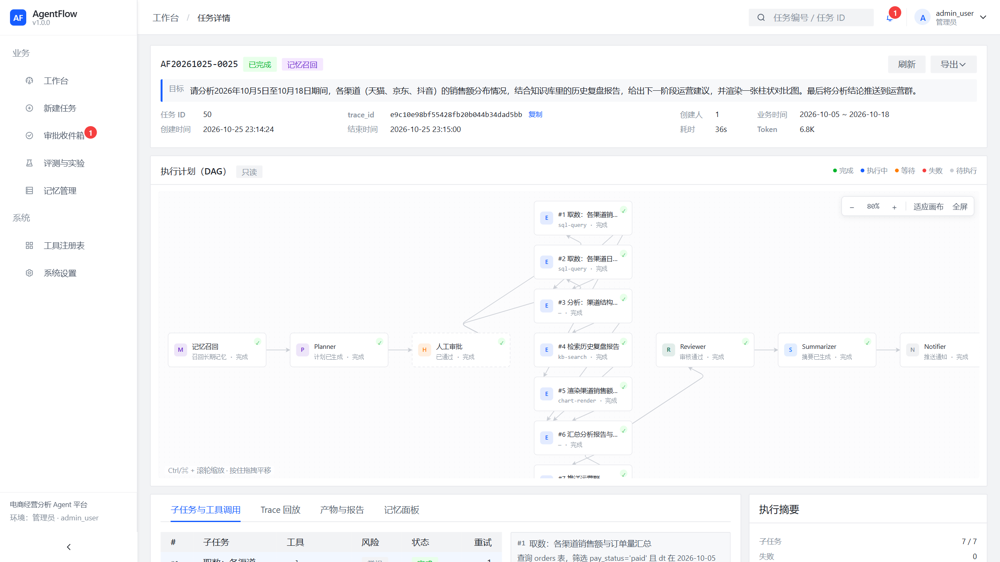
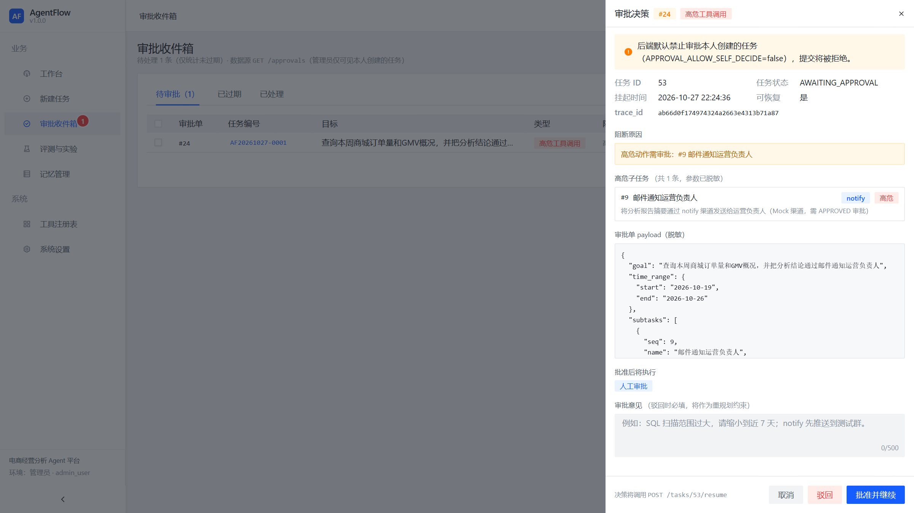

# AgentFlow Platform

**企业级多智能体任务编排与执行平台** · `v1.3.0`

> 一句话：**一个把"不可靠的大模型"关进可靠状态机里的任务编排平台**——带环 LangGraph 状态机 × 七类智能体协作 × 断点持久化 × Redis 分布式锁 × 三层成本熔断，715 个测试全绿。

```
用户一句目标 ──► Planner 拆 DAG ──► Executor 调 MCP 工具 ──► Reviewer 五维打分
                     ▲                                        │ 3.5 分不过线
                     └────────── Replan 带建议重做（≤2 轮）◄────┘
                                                              │ 过线
                                          高危动作 ──► Human Gate 挂起审批 ──► resume 续跑
```

| 指标 | 值 |
|---|---|
| 测试基线 | **715 passed / 0 failed / 0 skipped**（含分支覆盖 78.4%，状态机编排模块 89%，熔断器 95%） |
| 代码规模 | 后端 100+ 模块 · 前端 Vue3 工程 · 脚本 12 个 · 测试 60+ 文件 |
| 运行依赖 | Python 3.12 · MySQL 8.0 · **Redis Stack**（RediSearch，断点持久化必需） |
| 版本事实来源 | `app/__init__.py::__version__`（`/`、`/healthz`、CHANGELOG 三处对齐） |

---

## 1. 核心业务流转：一个"永远有出口"的环

七个角色各司其职，流转由**显式路由函数**控制（`app/agents/graph.py` 的 `route_after_*`），节点内部才有 LLM 自由度——"AI 会不会死循环"在图结构层面就不存在：

1. **memory_recall → Planner**：先对长期记忆做语义召回（本地 embedding + 余弦，阈值 0.55，`app/memory/`），Planner 把目标拆成 DAG 子任务，输出强校验 JSON——带围栏容错、残缺括号自动补全、多级修复重试（`app/agents/planner.py` + `app/agents/structured.py`）。
2. **Executor 逐节点执行**：每个工具调用套独立超时预算（kb 20s / sql 10s / chart 15s）、重试矩阵、熔断计数、幂等缓存（`app/agents/executor.py` 的 `_TOOL_BUDGETS` / `RETRY_MATRIX`）。
3. **Reviewer 五维打分**：format / evidence / consistency / completeness / faithfulness，**通过线 3.5、拒绝线 2.5、置信度下限 0.55**（`app/core/w2_config.py`）；LLM 连续 2 次输出不合规自动切本地规则兜底评分。
4. **评审打回即带环**：不过线 → `replan` 带着 suggestions 回 executor 重做，`REPLAN_MAX_COUNT=2` 硬上限——环永远有出口（`app/agents/replan.py`、`app/agents/graph.py::route_after_review`）。
5. **Human Gate 唯一挂起点**：高危动作触发 `interrupt()`，任务停 `AWAITING_APPROVAL`，审批 24h 过期由 sweeper 自动收口，且**即使 sweeper 挂了，第一个撞上过期审批的 decide 请求也会触发同款纠正**（`app/agents/human_gate.py`、`app/services/approval_service.py`）。
6. **终态清理**：任务完结删 checkpointer 快照线 + 取消信号，不留"长生不老"的 key（`app/services/task_cleanup.py`）。

## 1.5 系统架构与执行轨迹展示（真实运行截图）

**① 带环状态机 DAG 全绿流转**——任务 AF20261025-0025 完整跑通：`memory_recall → Planner → 人工审批 → 7 个子任务（sql-query ×2 / kb-search / chart-render ×2 / …）→ Reviewer → Summarizer → Notifier`，7/7 子任务 DONE，节点图由前端依据真实执行轨迹渲染（数据源 `GET /tasks/{id}` + SSE 事件流）：



**② Human-in-the-loop 挂起审批**——任务 AF20261027-0001 因规划出高危子任务（`#9 邮件通知运营负责人`，tool_hint=notify）被 human_gate 拦截挂起。抽屉同框呈现四道防线：**高危阻断原因**、**审批单参数已脱敏**（`app/utils/masking.py`）、**禁止审批本人创建的任务**（`APPROVAL_ALLOW_SELF_DECIDE=false` 守卫）、批准后经 `POST /tasks/{id}/resume` 从 Redis 断点继续——而不是从头重跑：



> 截图可复现：`node agentflow-web/scripts/readme_shots.cjs`（headless Edge 真实登录态截取）；挂起审批可用 `POST /api/v1/tasks`（目标含"邮件通知"）随时再造。

## 2. 硬核工程化：四大防线

### 防线一：并发与状态安全

- **Redis 分布式锁串行化 resume 写路径**——竞态窗口是"两个请求同时读到 AWAITING_APPROVAL、各自驱动一次图执行"。关键认知：checkpointer **直写 Redis 绕过 ORM，数据库行锁根本管不到它**，所以锁必须放在服务层入口。选型拒绝 RedLock（单实例 Redis 用不上）和 `Redis.lock()`（释放走 Lua，fakeredis 测试环境不支持），手写 `SET key token NX EX` + `WATCH` 事务比对释放——真实 Redis 与 fakeredis 通吃，持锁崩溃靠 TTL 兜底（`app/core/redis_lock.py`，模块头就是完整选型论证）。
- **状态闸双保险**：锁之外，resume 入口 `ensure_resumable` 再校验挂起态——终态任务不可能被再次驱动，即使锁失效也只是 409 而不是状态写花（`app/services/interrupt_service.py::ensure_resumable`）。
- **取消信号降级**：取消标记放 Redis，Redis 故障时记日志放行而不是把任务卡死——**辅助设施故障不放大成主链路故障**（`app/services/cancel_service.py`）。

### 防线二：极限成本控制

- **节点级 Token 硬预算**：planner 6000 / executor 8000 / reviewer 4000 / summarizer 5000，每次 LLM 调用前预检，超限抛 `TOKEN_BUDGET_EXCEEDED` **直接中断执行图**——重试风暴最多烧到预算线（`app/core/w2_config.py::token_budgets()`）。
- **用户级每日熔断**：请求数 + token 双计数，Redis 按日（UTC 口径）累计，达线拒新任务（`app/core/daily_quota.py`）。
- **工具级熔断器**：Redis 滑动计数，连续失败开闸、冷却后半开试探，防单工具故障拖垮全图（`app/core/circuit_breaker.py`，覆盖率 95.45%）。
- **上下文预算**：会话上下文 `CONTEXT_MAX_CHARS=12000` 硬顶；可选 `context_compress` 节点把累积 messages 压缩成 digest 并计入 token 台账（`app/agents/context_steps.py`）；工具返回值超长截断并如实标注 `truncated`（`app/services/context_service.py`）。

### 防线三：安全与治理

- **MCP 工具治理**：stdio/SSE 双传输对接，工具热启停、**版本路由**（`ToolVersionRouter`）、健康哨兵只管传输层瞬断（MCP_PROTOCOL_ERROR 自动重启子进程，仅限只读工具）——与语义层重试/熔断严格分工（`app/tools/mcp_client.py`、`app/tools/tool_governance.py`）。
- **强幂等**：`(task_id, tool, args)` 三元组哈希 + TTL 结果缓存，**重试前先查缓存——重试永不放大副作用**（防重复扣款/重复发消息）（`app/tools/tool_governance.py::IdempotencyStore`）。
- **SQL 白名单**：运行时 `inspect` 白名单表拉真实列名（TTL 1h 缓存）注入生成/修复 Prompt，标识符形状校验杜绝 DDL 注入拼接面；LLM 修 SQL 不再瞎编列名（`app/tools/sql_schema.py`、`tests/test_sql_query_security.py`）。
- **PII 脱敏**：Trace 落库前 dict/纯字符串双路径脱敏 + 削峰截断（`app/utils/masking.py`、`app/services/trace_service.py::_safe_payload`）；工具错误出 Agent 边界前 `sanitize_tool_error`；用户目标先过 `IntentGuardrail` 提示注入拦截（`app/agents/executor.py`、`app/core/guardrails.py`）。

### 防线四：可观测性（自研 + OTel 双轨）

- **基于 contextvars 的全链路 Trace**：请求进中间件注入 `trace_id/span_id/user_id/task_id`，执行期每个节点与工具调用带上下文落 TraceBuffer，异步批量削峰入库（`app/core/context.py`、`app/core/trace.py`、`app/services/trace_service.py`）。
- **OTel 旁路桥接**：标准协议导出可随时接公司 APM，span 异常吞掉不影响主链路，开关关闭零开销（`app/core/tracing_middleware.py`、`app/observability/otel_tracing.py`）。
- **持久层补丁自带可观测性**：对 `langgraph-checkpoint-redis 0.0.8` 的 checkpoint key 错位缺陷（每次保存覆盖上次快照 → interrupt 全丢）打了运行时补丁，升级路径留好（`app/services/redis_saver_patch.py`）。

## 3. 部署与环境

```bash
# A. 本机演示（推荐）
cd agentflow-platform
python scripts/demo_up.py --status   # 体检：四个组件在不在线，不启动任何东西
python scripts/demo_up.py            # 拉起缺失组件（默认 MOCK 知识库，离线可跑）
python scripts/demo_up.py --real     # 走项目一真实检索（只改子进程环境变量，不动 .env）

# B. 容器一键编排
cp .env.example .env
docker compose up -d --build         # mysql(3307) + redis-stack(6379) + backend(8000)
docker compose --profile frontend up -d    # 额外：Nginx(8080) 托管前端
```

| 组件 | 端口 | 说明 |
|---|---|---|
| MySQL 8.0 | **3307** | 任务/子任务/审批/轨迹/记忆（刻意避开系统实例 3306） |
| **Redis Stack** | 6379 | `redis/redis-stack-server`——断点持久化（RediSearch）+ 限流 + 熔断计数 + 事件流，**必须用 Stack 版** |
| AgentFlow 后端 | 8000 | `.venv\Scripts\python.exe -m uvicorn app.main:app --host 127.0.0.1 --port 8000` |
| 前端 / 项目一 | 5173 / 8010 | compose profile，默认不启动 |

种子与迁移：`scripts/seed_w3_demo_users.py`、`scripts/seed_mall_mysql.py`（幂等，`--check` 校验）；`scripts/dev_serve.py --backend-only` 可用 SQLite 纯本地起演示。

## 4. 测试与质量报告

```bash
mkdir -p .pytest_tmp reports
.venv/Scripts/python.exe -m pytest tests/ -v \
  --html=reports/report.html --self-contained-html \
  --cov=app --cov-report=html:reports/coverage \
  --basetemp=".pytest_tmp/run_$(date +%H%M%S)"
```

- **715 passed / 0 failed / 0 error / 0 skipped**（88.8s，JUnit XML + pytest-html 双口径核验）
- 双重隔离：内存 SQLite（每用例独立建表销毁）+ fakeredis——真实演示数据零接触
- 质量门禁：新增模块 `ruff` 零告警 · 前端 `vue-tsc` 0 error
- 代码库卫生：无死代码、零废弃文件——历史事故（超时全灭、管道超限、数值字符串化、SQL 丢列名）全部转化为回归用例钉死，**每个已知崩法都有测试在岗盯着**
- 详细指标与逐模块覆盖率：`docs/项目三质量报告说明.md`

## 5. 设计原则（写给读代码的人）

1. **大模型是"会犯错的下游服务"**：超时、重试、熔断、幂等一样不少——但治理手段之间要有全局预算视角，局部正确 ≠ 全局正确（5s 一刀切超时曾把 8~11s 的知识库检索"全灭"，三个各自正确的机制组合成自杀）。
2. **环必须有出口**：重规划硬上限、评审降级路径、审批过期收口——每条循环路径都终态可达。
3. **降级要可见**：语义召回降级关键词、评审降级本地规则、OTel 关闭零开销——降级永远对调用方如实暴露，不静默。
4. **辅助设施故障不放大**：Redis 挂、Trace 挂、sweep 挂，主链路都要能走完。
