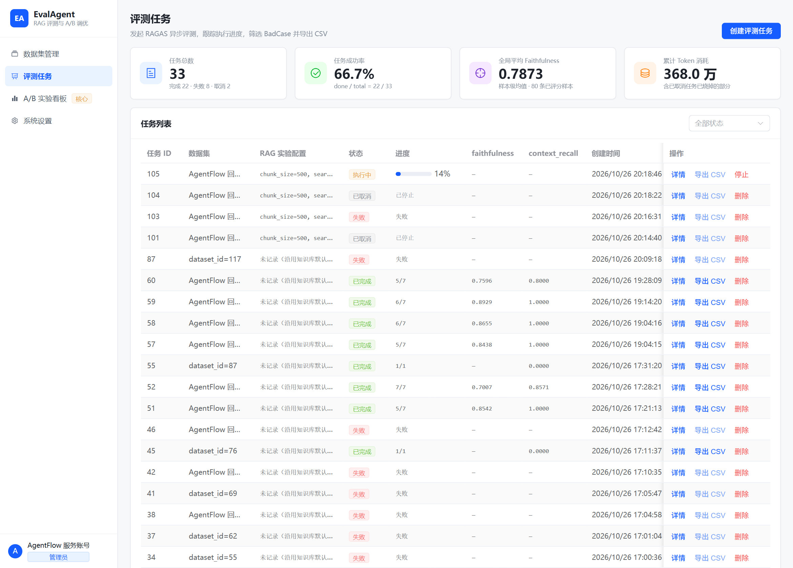
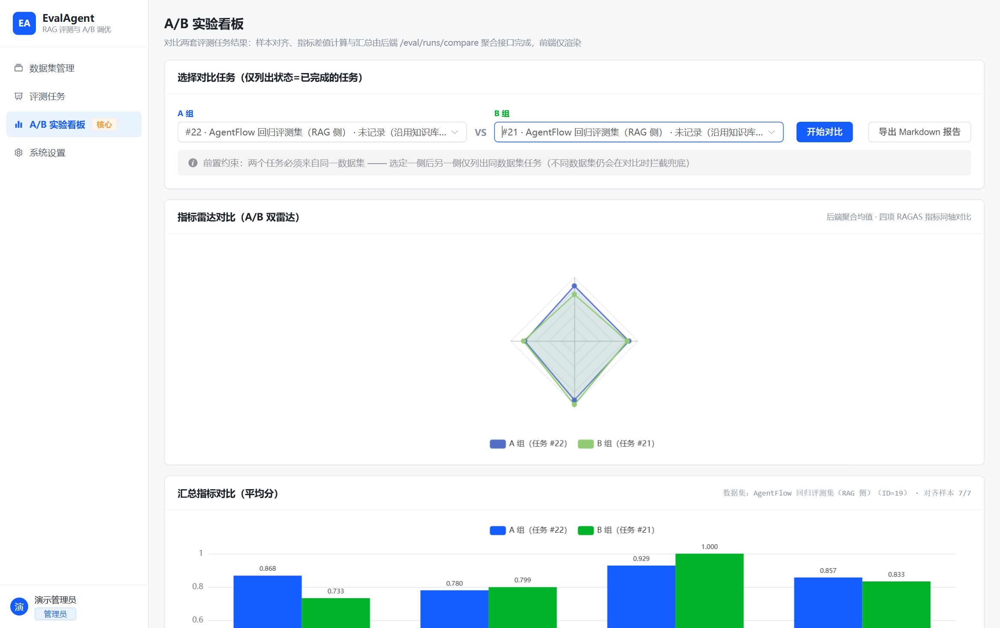
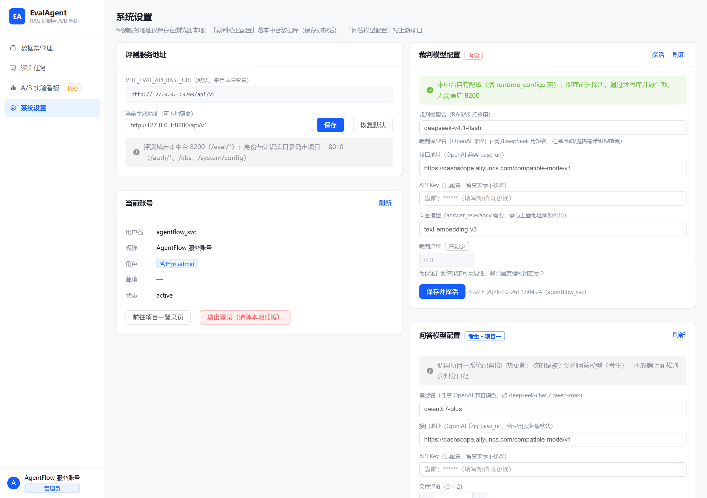

# EvalAgent — 中央评测中台

> 独立微服务化 RAG 评测平台：**算力隔离 + 可插拔裁判 + 可视化大盘**。Vue3 前端 + FastAPI 独立后端，对任意 RAG 系统做 RAGAS 四项指标（faithfulness / answer_relevancy / context_precision / context_recall）的客观打分与 A/B 对比。

```
EvalAgent/                       # Monorepo
├── evalagent_backend/           # FastAPI 后端（端口 8200，独立 MySQL 库）
│   ├── app/
│   │   ├── api/v1/              # runs / datasets / system / 双挂载路由
│   │   ├── core/                # config / auth / database / response
│   │   ├── models/              # ORM：eval_dataset / eval_run / eval_score / runtime_config
│   │   ├── schemas/             # Pydantic 请求/响应模型
│   │   └── services/            # judge / runner / rag_client / aggregate / serialize
│   ├── tests/                   # 11 个测试模块，128 用例
│   └── reports/                 # pytest-html + coverage 报告
├── evalagent_vue/               # Vue3 + TS + Element Plus 前端（端口 5174）
│   └── src/
│       ├── views/               # TaskView / AbCompareView / DatasetView / SettingsView
│       ├── components/          # RagRadarChart / BadCaseFilter / BadcaseDetailDrawer
│       └── api/                 # 双 axios 实例（8200 评测域 / 8010 上游域）
└── scripts/                     # puppeteer 验收截图脚本
```

---

## 效果展示

### 评测主界面（大盘 + 任务列表）



顶部四张 KPI 卡片（任务总数 / 成功率 / 全局平均 faithfulness / 累计 Token 消耗）+ 下方任务列表，支持进度轮询、中途停止、导出 CSV。

### A/B 对比（双雷达图）



双雷达图 + 汇总指标柱状图，样本对齐与差值计算在后端 `POST /eval/runs/compare` 完成，差值超阈值标黄。

### 裁判模型配置面板



考生/考官双面板分离，保存即 preflight 探活，通过才落库热生效。

---

## 架构与核心功能

### 算力隔离

EvalAgent 是**独立评测进程**，不寄生在被测系统内部。被测系统（项目一，8010）跑 RAG 问答，EvalAgent（8200）跑裁判打分，两者通过 HTTP 解耦、各自独立的数据库和 LLM 客户端。

**为什么必须隔离**：评测的负载特征（长时间、高并发、大量 token 消耗）与线上问答（低延迟、突发）完全不同。若混在一个进程里，一次跑批就会反过来拖垮线上问答——这就是"算力隔离"要解决的雪崩问题。代码层面，裁判（考官）与被测（考生）走两套独立配置：`JUDGE_*` 与 `UPSTREAM_RAG_*`（`app/services/runtime_config.py`）。

### 可插拔裁判（保存即探活）

裁判模型可以在界面上**热更新**，无需重启 8200。但"能填进去"不等于"能打分"，所以保存前必须先过 **preflight 结构探活**（`app/services/judge.py:317`）：

1. 连通且 `content` 非空（排除思考模式未关导致的空 content）；
2. 能按 RAGAS 要的 JSON 结构输出（排除"能聊天但吐不出 JSON"的模型）；
3. JSON 里要有 0~1 的数值字段（排除"形似"的假结构化输出）。

三档判定，任何一档不过就不落库，把错配挡在第一个样本之前。探活通过才写 `runtime_configs` 表并热生效。

### A/B 对比

双雷达图 + 指标差值可视化。后端 `POST /eval/runs/compare` 完成样本对齐、四项指标差值 Δ 计算，前端 `AbCompareView.vue` + `RagRadarChart.vue` 渲染双雷达，差值超阈值（`COMPARE_DIFF_THRESHOLD=0.1`）标黄。

### 任务管控

- **异步进度**：任务后台执行，逐条落库，前端进度条实时走；
- **中途停止（Cancel）**：执行中/排队中任务显示红色"停止"按钮，二次确认后置取消标记，执行器按 `RUN_CANCEL_POLL_SECONDS` 轮询感知并安全收尾（`app/services/runner.py:115`）；
- **状态机防死锁**：启动时 `recover_stale_runs` 回收僵死任务（进程被杀后 running 永久卡住的场景，`app/services/runner.py:663`），按 `RUN_STALE_SECONDS` 超时统一判死。

---

## 工程化落地与深水区排雷

这四件事都是真机踩过的坑，每个都有代码级证据：

### 1. 代理劫持排查 —— 强制直连

**现象**：打分偶发 `APIConnectionError`、超时 300s，看起来像"样本太难"或"模型不兼容"。

**根因**：本机存在 `HTTP(S)_PROXY` 环境变量，httpx 默认 `trust_env=True`，会把**连 `127.0.0.1:8010` 的本地请求也塞进代理**绕一圈，抖动时本地调用直接失败。

**方案**：`HTTP_TRUST_ENV=False`（`app/core/config.py:49`），所有裁判/上游/鉴权 httpx 客户端显式 `trust_env=False` 直连。证据：`app/services/judge.py:251`。

### 2. 向量空间对齐 —— 维度校验防静默空分

**现象**：answer_relevancy 稳定等于 0，比报错更难查，因为它长得像"模型相关性差"。

**根因**：个别网关/代理对不认识的 embedding 模型返回 `[[0.0]*dim]` 这种"成功但无意义"的全零向量；或维度不一致导致余弦相似度算错。

**方案**：`_probe_embeddings` 在探活时校验——能出向量、同一批文本维度一致、维度非 0、**不是全零**（`app/services/judge.py:374`）。同时 `check_embedding_ctx_length=False` 防止 langchain 把文本转 tiktoken id 数组发给非 OpenAI 端点导致 400（`app/services/judge.py:279`）。

### 3. 并发单例竞态修复 —— 裁判热更新时防 NaN

**现象**：并发打分时某条样本偶发 `NoneType has no attribute 'generate'`，指标静默变空。

**根因**：ragas 的四个指标是**模块级单例**，多线程并发 evaluate 会互相覆盖彼此的 `llm`/`embeddings` 引用；叠加裁判热更新时 `reload()` 把引用置 None，恰好跨在中间就拿到 None。

**方案**：每次打分前在 `_metric_lock` 锁内显式回填指标属性（`app/services/judge.py:451`）；`score()` 先取本地引用再传，`_build()` 用双检锁防重复重建（`app/services/judge.py:286`）。

### 4. 致命错误熔断 —— 额度耗尽立刻中止，不盲目重试

**现象**：额度耗尽时，整轮任务还在一条条重试，每条吃满 RAGAS 的退避，钱白烧、人也白等。

**根因**：没有区分"配置坏了"和"这条样本难"。前者重试无意义，后者应逐条记录、其余继续。

**方案**：`_is_fatal_judge_error` 识别 10 类致命特征（`AllocationQuota`/`FreeTierOnly`/`insufficient_quota`/`invalid_api_key`/`NotFoundError` 等，`app/services/runner.py:332`），命中即**立刻终止整轮**并写清根因，不再空转。

---

## 快速启动

依赖：项目一后端（被测系统）需先起，EvalAgent 才取得到答案。

```bash
# 1. 项目一后端（被测 RAG 系统，8010）—— 先起
cd <项目一目录>
.venv/Scripts/python.exe -m uvicorn app.main:app --host 127.0.0.1 --port 8010

# 2. EvalAgent 后端（8200）
cd EvalAgent/evalagent_backend
.venv/Scripts/python.exe -m uvicorn app.main:app --host 127.0.0.1 --port 8200
# 接口文档 http://127.0.0.1:8200/docs

# 3. EvalAgent 前端（5174）
cd EvalAgent/evalagent_vue
npm install
npm run dev
```

初始化/查看表结构（后端目录内）：

```bash
.venv/Scripts/python.exe scripts/init_db.py      # 建库 + 建表 + 打印结构
.venv/Scripts/python.exe scripts/dump_schema.py  # 导出 logs/schema.json（含列注释）
```

**裁判模型配置**：进入前端「系统设置 → 裁判模型配置」，填裁判模型名 / 接口地址 / API Key / 向量模型，点「保存并探活」，探活通过即热生效。裁判温度强制锁 0（保证可复现）。向量模型建议与项目一检索同源（bge-m3），保证"同指标跨平台可比"。

**端口约定**：

| 服务 | 端口 |
| --- | --- |
| 项目一后端（被测系统） | 8010 |
| EvalAgent 后端 | 8200 |
| EvalAgent 前端 | 5174 |

**接口双挂载**：同一套实现在两个前缀下都可用——`/api/v1/eval/*`（前端 axios 与项目三 `EVALAGENT_BASE_URL` 走这个）与 `/eval/*`（裸路径，方便 curl）。响应统一 `{code, message, data}`。

---

## 测试与质量报告

```
128 passed, 0 failed  in ~28s
Total coverage: 89%
```

| 深水区核心文件 | 覆盖率 |
| --- | --- |
| `app/services/judge.py`（裁判探活/维度校验/竞态锁/关思考） | 88% |
| `app/services/runner.py`（熔断/并发/补跑/取消/僵死回收） | 84% |
| `app/core/auth.py`（鉴权失败口径） | 88% |
| `app/services/aggregate.py`（聚合 + 缺失率） | 100% |

测试分布在 11 个模块，其中 **60+ 个用例集中在"深水区守卫"**——裁判防假成功、打分卫生、鉴权口径、熔断参数化，而非 CRUD 流水账。覆盖率与风险正相关：风险最高的代码恰恰是测试最密的地方。

```bash
cd evalagent_backend
.venv/Scripts/python.exe -m pytest tests/ \
  --html=reports/report.html --self-contained-html \
  --cov=app --cov-report=html:reports/coverage
```

报告产物：`reports/report.html`（测试结果）、`reports/coverage/index.html`（覆盖率站点）。
