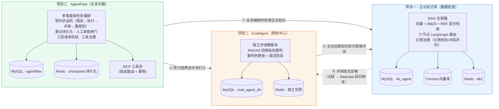

# AI 业务中台全景图

> **知识底座 → 业务编排 → 质量评测**：三个子系统不是孤立的 Demo，而是一条首尾相接的企业级微服务闭环。

| 项目 | 子仓库 | 职责 | 测试基线 |
|---|---|---|---|
| 项目一 | [企业垂直知识库 Agent 后台](./企业垂直知识库%20Agent%20后台) | 数据底座 · RAG 全链路 | 560 passed |
| 项目三 | [AgentFlow 多智能体任务编排平台](./AgentFlow%20——%20企业级多智能体任务编排与执行平台) | 业务大脑 · 任务编排 | 715 passed |
| 项目二 | [EvalAgent 评测中台](./EvalAgent) | 质检中心 · 算力隔离 | 128 passed |

---

## 一、一句话概括：AI 业务中台全景图

这是一套**可以自我进化的企业级 AI 业务中台**，而非三个摆在一起的技术 Demo。

它由三条生产线首尾咬合而成：

1. **知识底座**（项目一）：把企业散落在 PDF / Word / Excel 里的私有知识，变成「问得对、答得准、可溯源」的 RAG 问答能力——解决「AI 不知道公司的事」；
2. **业务大脑**（项目三）：用带环状态机的多智能体编排，把「一句话需求」拆解成可执行、可审批、可断点续跑的业务任务流——解决「AI 只会答，不会干」；
3. **质检中心**（项目二）：用独立的评测进程给前两者打分，四维 RAGAS 指标 + 向量空间对齐，把「感觉变好了」变成「数字上真的变好了」——解决「AI 自己说不清自己好不好」。

**三者通过 HTTP 微服务解耦、通过统一裁判标尺对齐，形成一个「生产 → 评测 → 反哺生产」的完整飞轮。** 这不是功能叠加，而是把一条 AI 产品从「能跑」推到「可信赖、可持续迭代」的完整工程闭环。

---

## 二、核心架构图

**数据流转说明：**

| 链路 | 方向 | 作用 |
|---|---|---|
| ① 编排 ↔ 知识 | 项目三 → 项目一 | AgentFlow 执行任务时，通过 MCP 工具检索企业知识库取数（HTTP 解耦） |
| ② 编排 → 评测 | 项目三 → 项目二 | 任务执行结果送入 EvalAgent，跑 RAGAS 四维指标客观打分 |
| ③ 评测 → 知识 | 项目二 → 项目一 | EvalAgent 作为独立裁判，主动拉取知识库的问答对进行离线评测 |
| ④ 评测 → 知识 | 项目二 → 项目一 | 评测结论（点踩）反哺知识库，沉淀为 Badcase 回归样本 |

---

## 三、三大子系统职责与亮点

### 1. 企业知识库问答系统（RAG 全链路）

> **职责：数据底座** —— 把企业私有知识变成可溯源、防幻觉的问答能力。

| 维度 | 选型 / 机制 |
|---|---|
| 后端 | FastAPI + SQLAlchemy |
| 编排 | LangGraph 六节点状态图（classify → rag / db_query / report / parallel_compare → answer） |
| 混合检索 | 向量（Chroma）+ BM25 + RRF 倒数排名融合（k=60），可选余弦重排，外部 embedding 故障自动降级纯 BM25 |
| 幻觉治理 | 后置引用校验 `citation_guard`（硬事实子串比对 + 块号校验）+ 冲突并列（不硬选一条，交由用户判断） |
| 存储 | MySQL 8 + Chroma 向量库 + Redis（令牌桶 Lua 原子限流，独占 db1） |
| 质量基线 | **560 passed / 0 failed**，代码覆盖率 **82%** |

**亮点：** 不是「套壳 LLM」，而是从解析（跨页续表回填、DOCX 原位遍历）到检索（双路召回 + RRF 融合）再到生成（引用校验 + 冲突并列）的完整 RAG 链路，外加「点踩转 Badcase」的数据飞轮，让系统越用越准。

### 2. 多智能体任务编排平台（AgentFlow）

> **职责：业务大脑** —— 把一句话需求拆解成可执行、可审批、可断点续跑的任务流。

| 维度 | 选型 / 机制 |
|---|---|
| 后端 | FastAPI + LangGraph |
| 状态机 | 带环状态机 × **七类智能体协作**（memory_recall / Planner / Executor / Reviewer / Replan / Human Gate / 终态清理），显式路由函数控制流转 |
| 断点持久化 | langgraph-checkpoint-redis，任务任意节点中断后可恢复续跑 |
| 三层成本防线 | ① 单任务 Token 熔断 ② 全局限流（固定窗口 + 令牌桶，用户/任务双维度）③ 工具级熔断（连续失败 N 次冷却） |
| 工具治理 | MCP 客户端唯一咽喉处加 `ToolVersionRouter`（版本路由 + 未部署自动回退）+ `IdempotencyStore`（幂等保护，超时重试不重复副作用） |
| 质量基线 | **715 passed / 0 failed**，分支覆盖率 **78.4%**（状态机编排 89%、熔断器 95%） |

**亮点：** 用「状态机 + 断点持久化」解决了多智能体编排的两大顽疾——长任务跑一半崩掉、以及「规划—执行—评审」质量不达标时如何自动回炉重造；用「三层成本防线 + 工具治理」把「AI 烧钱」和「重复副作用」两个工程风险摁死在代码层。

### 3. AI 评测中台（EvalAgent）

> **职责：质检中心（算力隔离）** —— 独立进程给前两者打分，让「好不好」有数字依据。

| 维度 | 选型 / 机制 |
|---|---|
| 架构 | 独立 Vue3 + TypeScript + Element Plus 前端 + FastAPI 后端微服务（与被测系统 HTTP 解耦，各自独立库） |
| 裁判 | 可插拔裁判模型，**保存即探活**（preflight 结构探活：连通性 → JSON 结构 → 0~1 数值三档校验，防假结构化输出） |
| 指标对齐 | 裁判向量模型与知识库检索同源（bge-m3），保证「同指标跨平台可比」，分数具备物理意义 |
| 深水区排雷 | 代理劫持强制直连、向量维度校验防静默空分、并发单例竞态锁、致命错误熔断 |
| 质量基线 | **128 passed / 0 failed**，代码覆盖率 **89%**（其中 60+ 用例集中在深水区守卫，而非 CRUD 流水账） |

**亮点：** 把「AI 评测」从「跑个 benchmark 看个分数」升级为「可插拔裁判 + 探活防呆 + 向量空间对齐 + A/B 对比」的完整质检体系。覆盖率达到 89% 且与风险正相关——风险最高的裁判、熔断、鉴权代码恰恰是测试最密的地方。

---

## 四、架构演进与工程取舍

### 1. 为什么做「微服务解耦」？

知识（项目一）、业务（项目三）、评测（项目二）三类能力的**变更节奏完全不同**：知识库要频繁改检索与清洗策略，编排要频繁改状态机与工具，评测要频繁换裁判模型。若揉在一个进程里，任何一处升级都要整体回归、整体发版、整体背锅。拆成三个独立服务后，**职责单一、边界清晰**——知识库负责「答得准」，编排负责「干得成」，评测负责「评得公」，各自独立部署、独立扩容、独立演进。

### 2. 为什么做「算力隔离」？

评测是**重任务**：长耗时、高并发、巨量 token 消耗，负载特征与线上问答（低延迟、突发）完全相反。若让评测寄生在被测系统内部，一次离线跑批就可能反过来拖垮线上问答的并发——这是典型的「雪崩」风险。所以 EvalAgent 独立成进程（独立库、独立 LLM 客户端），裁判（考官）与被测（考生）走两套独立配置，**把「重负载」与「生产并发」物理隔离**，评测跑批再也不影响生产。

### 3. 为什么统一「裁判标尺」？

评测的「向量空间」必须与知识库「检索向量空间」**同源对齐**，分数才有物理意义。如果裁判用 A 向量模型、知识库检索用 B 向量模型，两者的余弦相似度口径不一致，`answer_relevancy` 这类指标就会失真——分数看起来正常，实则「测了个寂寞」。所以 EvalAgent 的裁判向量模型与项目一检索同源（bge-m3），确保**「同指标跨平台可比」**，评测结论才能真正指导知识库迭代。

---

## 五、测试与质量基线

**总计 1403 个自动化测试用例，三个项目全部全绿封版。**

| 项目 | 测试用例 | 覆盖率 | 说明 |
|---|---|---|---|
| 项目一 · RAG 知识库 | 560 passed | 82% | 幻觉校验 `citation_guard` 100%、混合检索 95%、分块 94% |
| 项目三 · AgentFlow 编排 | 715 passed | 78.4% | 状态机编排 89%、熔断器 95%；含工具治理、成本防线、断点持久化等 60+ 测试文件 |
| 项目二 · EvalAgent 评测 | 128 passed | 89% | 60+ 用例集中在深水区守卫（裁判防假成功、打分卫生、鉴权口径、熔断参数化） |
| **合计** | **1403** | — | 三个项目全绿封版 |

**核心方法论：用传统软件工程的确定性，去兜底大模型的不确定性。**

大模型的输出天然不确定，但工程可以确定——所以我把「不确定」挡在测试边界之外：

- **检索**用 RRF 融合 + 降级策略，确定「永远有上下文可用」；
- **生成**用引用校验 + 冲突并列，确定「幻觉被标记、矛盾被暴露」；
- **编排**用状态机 + 断点持久化，确定「任务能回环、能续跑」；
- **成本**用三层防线，确定「烧钱有上限、副作用不重复」；
- **评测**用探活防呆 + 向量对齐，确定「分数是真的、可比的」。

**1403 个用例不是数字的堆砌，而是把「AI 靠不住的地方」一条条用测试钉死的过程。** 当模型换了一版、知识库加了一批文档、编排多了一个工具时，这 1403 个绿灯就是「没改坏」的最硬证据。
