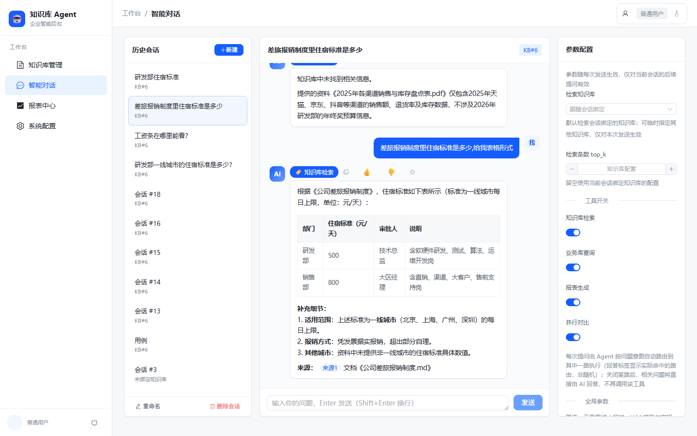
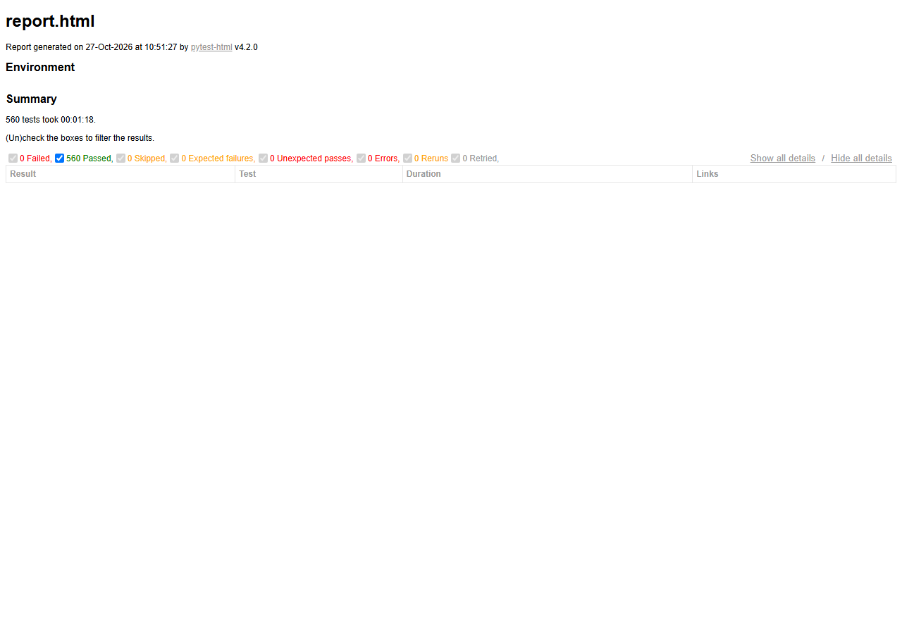

# 企业垂直知识库 Agent 后台

> 面向企业内部的垂直知识库 + 智能问答平台：**RAG 多路混合召回 · 防幻觉治理 · 生产级工程化**。
> 一句话：把企业散落在 PDF/Word/Excel 里的私有知识，变成「问得对、答得准、可溯源、有评测」的生产级问答系统，而不是一个套壳 LLM 的 Demo。

---

## 核心亮点（含源码级证据）

### 1. 复杂表格解析 —— 跨页续表回填、DOCX 原位遍历
- **PDF 跨页续表回填**：`loader.py` 通过页边距/底部比例/数据行特征（含数字）三重判定，识别「上一页表格延续到本页」，自动回填上一页表头，解决「跨页表格丢了表头、数据对不上列」的深水区问题。
- **DOCX 原位遍历**：不依赖文本层，直接遍历 OOXML 的 `<w:tbl>` 表格节点，保留单元格原始归属。
- **分块表头补全**：`splitter.py` 的 `_table_prefixes` 为每个从表格中段切出的块，前置「表头 + 分隔线」，保证块脱离上下文后仍能独立理解。
- 证据：`app/rag/loader.py`、`app/rag/splitter.py`

### 2. 混合检索 —— 向量 + BM25 + RRF 融合 + 可选重排 + 降级
- **双路召回**：向量语义召回（Chroma）+ BM25 字面召回（本地内存索引，零外部依赖），RRF 倒数排名融合（`_RRF_K=60`），兼顾「语义相似」与「关键词精确命中」。
- **可选重排**：知识库配置 `rerank_threshold > 0` 时，对融合候选按「查询向量与块向量的余弦相似度」重排并过滤低于阈值的结果。
- **优雅降级**：外部 embedding 不可用（欠费 402 / 密钥失效 401 / 超时）时自动降级纯 BM25，充值后自动恢复双路，无需改配置重建索引。
- 证据：`app/rag/retriever.py`、`app/rag/bm25.py`

### 3. 幻觉治理 —— 后置引用校验 + 冲突并列
- **后置引用校验（citation_guard）**：把答案里的「硬事实」（≥3 位长数字、日期）抽出来到检索上下文做子串比对；并校验答案声称的「《文档》第 N 块」是否真在本次下发的上下文里（v1.13 补的块号口子）。只标记 `suspect`、不拦截——「防误杀优先」。
- **冲突并列**：检索到相互矛盾的信息时，不硬选一条，而是把冲突并列呈现给用户，交由用户判断。
- 证据：`app/rag/citation_guard.py`、`app/agent/graph.py`

### 4. 自动化评测与数据飞轮 —— RAGAS 四指标 + 点踩转 Badcase
- **RAGAS 四指标**：faithfulness / answer_relevancy / context_precision / context_recall，异步评测 + 每样本即时落库（`EVAL_SCORE_BATCH_SIZE=1`）。
- **点踩转 Badcase 数据飞轮**：用户点踩 → `POST /chat/badcase` 自动沉淀进按知识库聚合的「用户反馈 Badcase」评测集，形成「线上负反馈 → 回归样本」的闭环。
- 证据：`app/services/eval_service.py`、`app/api/v1/chat.py`

---

## 工程化与架构防御

### Schema 启动自检（fail-fast）
`create_all` 只建缺失表、不给存量表补列，ORM 新增字段会潜伏到某个接口读写该列时才以 `Unknown column` 的 500 暴露。`schema_check.py` 启动时比对 ORM 与真实库结构，发现缺列直接给出可复制的 `ALTER TABLE` 并中止启动（`SCHEMA_CHECK_MODE=strict`），把「部署/升级错误」挡在进程启动阶段，而不是让它在演示时炸出来。
证据：`app/core/schema_check.py`

### 参数热更新与密钥脱敏（API Key 掩码）
- **热更新**：限流 / 重试 / LLM 模型等参数在「系统配置页」在线修改即时生效，无需重启（`runtime_config` 覆盖值优先于 `.env`）。
- **密钥脱敏**：`get_config` 对 LLM / Embedding / 评测的 API Key 永远返回掩码（`SECRET_MASK="******"`），真实值仅 `get_secret` 内部提供，防止密钥经配置查询接口泄露。
证据：`app/core/runtime_config.py`

### 高并发保护（Redis Lua 令牌桶限流 + 异步评测削峰）
- **令牌桶限流**：`rate_limit.py` 用 Redis **Lua 原子脚本**实现每用户每分钟令牌桶（支持突发容量 + 匀速补充），超限抛 429；Redis 异常时 fail-open（放行 + WARNING），限流是防护手段，不能因缓存故障把问答业务打挂。Redis 独占 `db1`，与同机其它服务隔离。
- **异步评测削峰**：评测用 `ThreadPoolExecutor` 异步执行 + 并发上限（活跃任务数 / 单任务 worker 数），防上游 429；僵死任务自动回收。
证据：`app/api/rate_limit.py`、`app/services/eval_service.py`

### 全链路可观测性（双 Trace 通道）
- **通道一 · 请求级**：`middleware.py` 为每个 HTTP 请求生成 TraceID（contextvars 透传），配合 stdout 结构化日志，快速定位「哪个请求出的问题」。
- **通道二 · 落库追踪**：`tracing.py` 通过 LangChain 回调挂到 LangGraph 图上，采集各节点（router / rag_tool / db_query_tool / report_tool / parallel_compare）的执行耗时、工具输入输出、token 用量，`flush()` 落 `trace_logs` / `trace_tool_calls`；并独立观测 `finish_reason=length` 截断（`is_truncated` 标记）。
- 关键设计：Trace 写入失败只打 error 日志，**绝不中断主问答流程**。
证据：`app/core/tracing.py`、`app/core/middleware.py`

---

## 效果展示

### 问答溯源（引用卡片）

每次回答都附带可点击的引用来源，精确到「文档 + 分块」，点击即可定位原文；幻觉嫌疑会被 `citation_guard` 标记 `suspect`，让用户一眼看清「这句话有据可查，还是模型脑补」。



### 自动化测试报告（560 passed）

全量 `560 passed / 0 skipped / 0 failed`，代码覆盖率 82%；风险最集中的幻觉校验、混合检索、分块模块覆盖率均 ≥ 94%。完整报告见 `docs/test_reports/report.html`。



---

## 快速启动

> 依赖：Python 3.11+、MySQL 8、Redis 6+（或 Docker 一键编排）

### 方式一：本机部署

```bash
# 1. 安装依赖
python -m venv .venv
.venv/Scripts/pip install -r requirements.txt      # Windows
# source .venv/bin/activate && pip install -r requirements.txt   # macOS/Linux

# 2. 配置环境变量（.env.example 已含全部键的说明，勿硬编码真实密钥）
cp .env.example .env
# 关键项：DATABASE_URL / REDIS_URL / SECRET_KEY / LLM_PROVIDER / LLM_API_KEY / LLM_MODEL

# 3. 初始化管理员（其余表启动时自动创建）
.venv/Scripts/python scripts/seed.py --username admin --password <你的密码> --role admin

# 4. 启动后端（默认 http://127.0.0.1:8000，接口文档 /docs）
.venv/Scripts/python -m uvicorn app.main:app --reload

# 5. 启动 Vue 前端（开发模式）
cd frontend_vue && npm install && npm run dev
```

### 方式二：Docker 一键编排

```bash
cp .env.example .env        # 按需填写 LLM_* 等配置
docker compose up -d        # 启动 MySQL + Redis + 应用
docker compose exec app python scripts/seed.py --username admin --password <你的密码> --role admin
```

### 环境变量说明（`.env.example`）

| 键 | 作用 |
|---|---|
| `DATABASE_URL` | MySQL 连接串，目标库 `kb_agent` 需先通过 `scripts/init_db.sql` 创建 |
| `REDIS_URL` | Redis 连接串，**建议每项目独占一个库号**（本项目默认 `/1`） |
| `SECRET_KEY` | 签名 session/refresh token 的随机长串（`secrets.token_urlsafe(48)` 生成） |
| `LLM_PROVIDER` / `LLM_API_KEY` / `LLM_MODEL` | 大模型提供方（`openai` 兼容 / `anthropic` / `mock`） |
| `EMBEDDING_PROVIDER` / `EMBEDDING_API_KEY` / `EMBEDDING_MODEL` | 向量化提供方 |
| `LLM_MAX_TOKENS` | 单次回答最大输出 token（默认 2048），命中上限时 `is_truncated` 标记 |
| `CHAT_HISTORY_MAX_TURNS` / `CHAT_HISTORY_MAX_CHARS` | 历史滑动窗口（默认 5 轮 / 2000 字） |
| `SESSION_TTL_SECONDS` / `REFRESH_TTL_SECONDS` | 会话滑动有效期 |
| `TOKEN_MAX_LIFETIME_SECONDS` | 一次登录的绝对生命周期（默认 30 天，续期不重置） |
| `SCHEMA_CHECK_MODE` | Schema 启动自检模式：`strict`（默认，发现漂移即中止）/ `warn` / `off` |

完整说明见 `.env.example` 文件内注释。

---

## 测试与质量报告

**全量测试基线：`560 passed / 0 skipped / 0 failed`**

- 运行环境：SQLite 隔离库（用例级独立临时库）+ 真实 Redis `db1`（令牌桶 Lua 用例需真实 Redis）+ Mock LLM/Embedding（不消耗额度、不依赖外网）。
- 总耗时约 78 秒。
- **代码覆盖率：TOTAL 82%**（4819 语句 / 860 未覆盖）。

风险集中模块覆盖极高：

| 模块 | 覆盖率 |
|---|---|
| `rag/citation_guard.py`（幻觉校验） | **100%** |
| `rag/bm25.py` | 97% |
| `rag/retriever.py`（混合检索） | **95%** |
| `rag/splitter.py`（分块） | 94% |
| `services/eval_service.py`（评测） | 86% |

测试报告与覆盖率报告（真实执行结果，未做人工修改）已提交至 `docs/test_reports/` 目录：

```
docs/test_reports/
├── report.html        # pytest-html 单文件报告（560 用例明细）
├── coverage/          # coverage.py HTML 报告（逐文件覆盖率）
├── last_run.log       # 最近一次完整终端输出
└── archive/           # 历史报告归档
```

复现测试：

```bash
# 安装测试依赖
.venv/Scripts/python -m pip install -r requirements-dev.txt

# 全量测试 + 两份报告（保持 SQLite 隔离，勿覆盖 DATABASE_URL）
FAKE_REDIS=false REDIS_URL="redis://127.0.0.1:6379/1" SECRET_KEY="pytest-secret-key" LLM_PROVIDER=mock \
.venv/Scripts/python -m pytest tests/ \
  --basetemp=".pytest_tmp/run_$(date +%H%M%S)" \
  --html=docs/test_reports/report.html --self-contained-html \
  --cov=app --cov-report=term --cov-report=html:docs/test_reports/coverage
```

> ⚠️ **安全护栏**：全量测试严禁将 `DATABASE_URL` 指向真实库。部分夹具会在 `finally` 中执行 `Base.metadata.drop_all`，若 `DATABASE_URL` 指向真实 `kb_agent`，每次用例都会 DROP 一次生产表。已在 `tests/conftest.py` 加装守卫（只放行 SQLite / `*_test` / 显式 `KB_AGENT_ALLOW_DESTRUCTIVE_TESTS=1`）。

---

## 目录结构

```
app/            # FastAPI 后端
  ├── agent/    #   LangGraph 六节点路由（classify/rag/db_query/report/parallel_compare/answer）
  ├── rag/      #   解析、分块、混合检索、BM25、向量库、引用校验
  ├── eval/     #   RAGAS 评测指标
  ├── core/     #   配置、Schema 自检、Trace、限流、安全
  ├── api/      #   路由与依赖（鉴权/RBAC/限流）
  └── services/ #   业务服务（对话/评测/知识库/用户）
frontend_vue/   # Vue3 + Element Plus 前端
docs/           # 需求、交付清单、测试用例与报告
scripts/        # 建库 SQL、seed 脚本、冒烟测试
samples/        # 演示知识库样例文档
tests/          # pytest 测试（560 例）
```

---

## 演示指引（5 分钟上手）

1. 管理员登录 Vue 前端 → 「知识库管理」新建知识库，上传 `samples/企业运维知识库样例.md`；
2. 「智能对话」新建会话（绑定该知识库）提问：
   - “打印机卡纸怎么办” → RAG 检索路由（引用来源标注文档与分块）
   - “公司现在有多少台设备” → 业务库查询路由
   - “生成设备汇总报表” → 报表路由（「报表中心」可预览/下载）
3. 「Trace 链路日志」查看本次问答的路由、工具调用明细与耗时；
4. 「系统配置」修改限流 / 重试 / LLM 模型，保存后立即生效；
5. 普通用户账号（`scripts/seed.py --role user`）登录验证权限隔离。

---

## 技术栈

| 层 | 选型 |
|---|---|
| 后端 | FastAPI + SQLAlchemy |
| 编排 | LangGraph（六节点状态图） |
| 向量库 | Chroma（持久化） |
| 混合检索 | 向量 + BM25 + RRF 融合 + 可选余弦重排 |
| 评测 | RAGAS（faithfulness / answer_relevancy / context_precision / context_recall） |
| 缓存 / 限流 | Redis（令牌桶 Lua 原子脚本，独占 db1） |
| 数据库 | MySQL 8（`kb_agent`） |
| 前端 | Vue3 + Element Plus（另附 Streamlit 轻量前端） |
